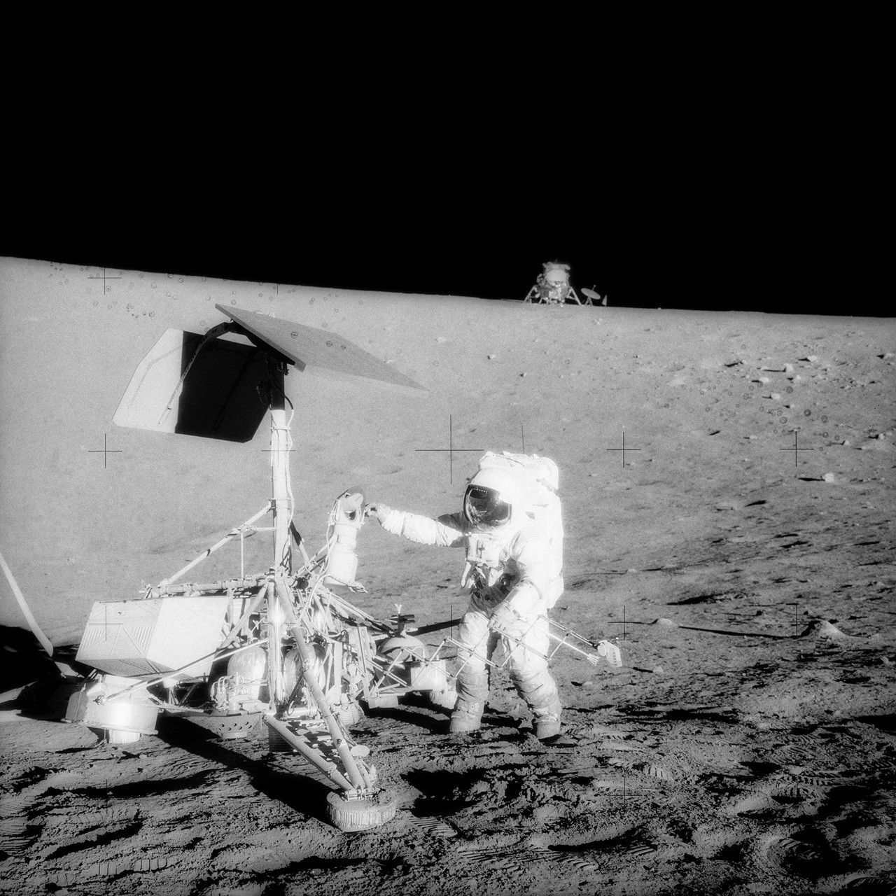

# Apollo 12 Lunar Module "Intrepid" & ALSEP: Precision Landing and Surveyor 3 Rendezvous


*Figure 1: Apollo 12 Commander Charles "Pete" Conrad Jr. visits the Surveyor 3 robotic lander in Oceanus Procellarum, with Lunar Module Intrepid resting 180 meters away on the lunar plain.*

## Overview & Quick Facts

The **Apollo 12 Lunar Module (LM-6)**, christened **"Intrepid"**, was the second crewed vehicle in human history to land on the Moon. Carrying Commander **Charles P. "Pete" Conrad Jr.** and Lunar Module Pilot **Alan L. Bean**—the third and fourth human beings to walk on the lunar surface—Apollo 12 was launched on November 14, 1969, aboard a mighty Saturn V rocket.

While Apollo 11 proved that humans could land on the Moon, Apollo 12 proved that astronauts could execute a **pinpoint landing** at an exact predetermined scientific site. On November 19, 1969, Conrad and Bean set Intrepid down in the Ocean of Storms just **180 meters (197 yards)** from the inactive robotic **Surveyor 3** spacecraft, which had landed two and a half years earlier. Apollo 12 deployed the first full **Apollo Lunar Surface Experiments Package (ALSEP)**, completed two moonwalks totaling nearly 8 hours, and retrieved 34.35 kg of lunar samples along with components of Surveyor 3.

| Parameter | Specification |
| :--- | :--- |
| **Spacecraft Name** | Apollo 12 Lunar Module (LM-6 / "Intrepid") & ALSEP |
| **NSSDCA / COSPAR ID**| 1969-099C |
| **Launch Date** | November 14, 1969 (16:22:00 UT / 11:22 a.m. EST) |
| **Launch Site** | Kennedy Space Center, Launch Complex 39A, Florida |
| **Launch Vehicle** | Saturn V (AS-507) |
| **Mission Funding / Management**| NASA Office of Manned Space Flight & Office of Space Science |
| **Total LM Spacecraft Mass** | 33,588 lbs (15,235 kg) (including propellants) |
| **Ascent Stage Mass** | 5,254 lbs (2,383 kg) dry; 10,489 lbs (4,758 kg) fueled |
| **Descent Stage Mass** | 4,669 lbs (2,118 kg) dry; 23,099 lbs (10,477 kg) fueled |
| **Lunar Touchdown Date** | November 19, 1969 (06:54:35 UT / 1:54:35 a.m. EST) |
| **Landing Coordinates**| 3.0128° S latitude, 23.4219° W longitude (Oceanus Procellarum) |
| **Lunar Surface Stay Time**| 31 hours, 31 minutes, 12 seconds |
| **Total Moonwalks (EVA)** | 2 EVAs (Total duration: 7 hours, 45 minutes, 18 seconds) |
| **Total Traversed Distance**| 1.35 kilometers (0.84 miles) |
| **Lunar Samples Returned**| **34.35 kilograms (75.7 lbs)** of rock and soil cores |

---

## Lunar Module Architecture & Propulsion

The Apollo Lunar Module was a two-stage spacecraft designed exclusively for flight in the vacuum of space:

### 1. Descent Stage
- An octagonal prism 4.2 meters across and 1.7 meters tall, supported by four truss-structure landing legs with round footpads spanning 9.4 meters diagonally.
- Contained the deep-throttling TRW Descent Engine (throttleable from 4,500 N to 45,000 N thrust) mounted on gimbals, burning Aerozine 50 and nitrogen tetroxide oxidizer.
- Housed storage bays for lunar surface exploration equipment, tools, sample return containers, and the ALSEP scientific package.
- Served as the launching launchpad for the Ascent Stage and remains on the Moon today.

### 2. Ascent Stage
- The crew cabin containing control consoles, flight computers, life support systems, communications, and the Bell Aerosystems Ascent Engine (producing 15,600 N of fixed thrust).
- Featured 16 reaction control thrusters arranged in four quads for attitude control.

---

## The ALSEP Science Station & Power

Apollo 12 deployed the first full-scale **Apollo Lunar Surface Experiments Package (ALSEP)** on the lunar surface, connected to a Central Station powered by a nuclear **SNAP-27 Radioisotope Thermoelectric Generator (RTG)**:
- **SNAP-27 RTG**: Generated 70 W DC at 16 V from the radioactive decay of a 4 kg fuel capsule of plutonium-238 ($^{238}Pu$), transferring heat through 442 lead-telluride thermocouples. The ALSEP operated continuously for nearly eight years until shut down by NASA on September 30, 1977.

### ALSEP Scientific Payloads:
1. **Passive Seismic Experiment (PSE)**:
   - Measured moonquakes, meteoroid impacts, and tidal stresses.
2. **Suprathermal Ion Detector Experiment (SIDE)**:
   - Measured positive ions in the lunar exosphere and solar wind interactions.
3. **Cold Cathode Ion Gauge (CCIG)**:
   - Measured ambient lunar atmospheric pressure down to $10^{-12}$ torr.
4. **Lunar Surface Magnetometer (LSM)**:
   - Measured local magnetic fields and subsurface electrical conductivity.
5. **Solar Wind Spectrometer (SWS)**:
   - Analyzed energy and flux of solar wind electrons and protons.
6. **Lunar Dust Detector**:
   - Assessed dust accumulation, radiation damage to solar cells, and temperature profiles.
7. **Solar Wind Composition (SWC) Foil**:
   - Aluminum foil sheet deployed during EVA 1 to capture noble gas ions from the solar wind for return to Earth.

---

## Surface Operations & The Surveyor 3 Examination

```
   Apollo 12 Lunar Surface Timeline (Oceanus Procellarum)
   -------------------------------------------------------
   Nov 19, 06:54 UT: Touchdown at Surveyor Crater (3.01° S, 23.42° W).
   Nov 19, 11:32 UT: EVA 1 begins (3 hr 56 min).
                     - Deployed ALSEP and nuclear SNAP-27 RTG.
                     - Set up Solar Wind Composition foil.
                     - Collected contingency and bulk regolith samples.
   Nov 20, 03:54 UT: EVA 2 begins (3 hr 49 min).
                     - 1.3 km geologic traverse around crater rims.
                     - Visited Surveyor 3 lander 180 meters from LM.
                     - Retrieved TV camera, soil scoop, and tubing.
                     - Collected core tube samples and 34 kg rocks.
   Nov 20, 14:25 UT: Ascent stage lifts off to rendezvous with CSM Yankee Clipper.
   Nov 20, 20:21 UT: Jettisoned Ascent stage deliberately crashes into Moon,
                     creating the first recorded artificial moonquake.
```

### The Deliberate Ascent Stage Moonquake
After docking with Command Module Pilot Richard Gordon aboard *Yankee Clipper*, the ascent stage was jettisoned and commanded to crash into the Moon. It struck at 3.94° S, 338.80° E, about 60 km from the freshly deployed Apollo 12 seismometer, producing shockwaves that reverberated through the Moon for over an hour ("ringing like a bell") and revealing the extraordinarily dry, fractured nature of the lunar crust.
