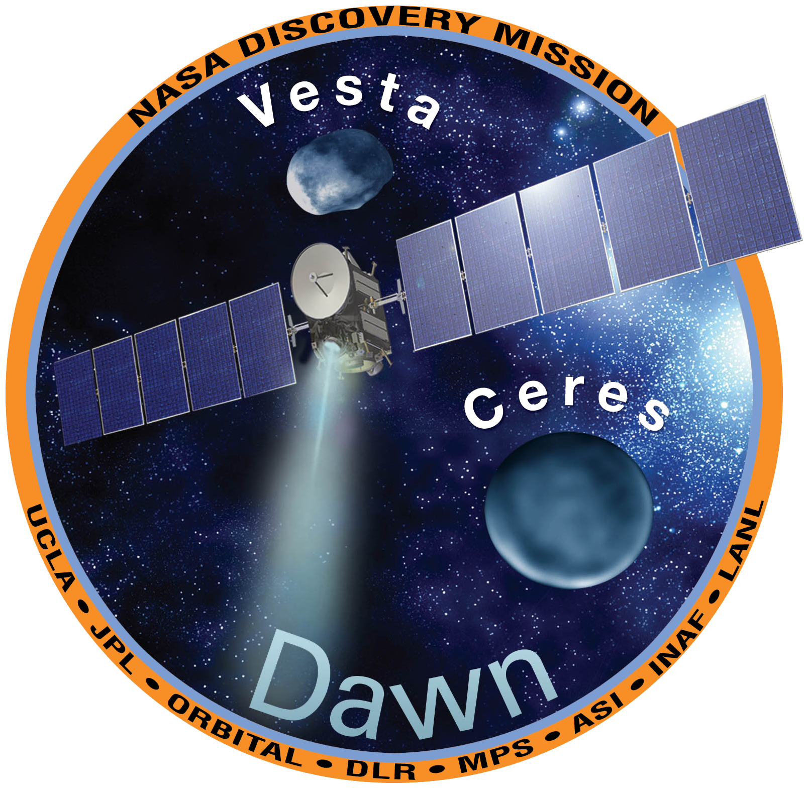
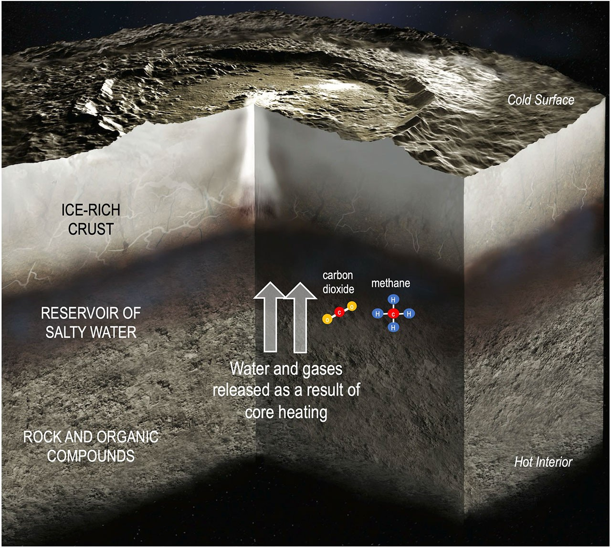
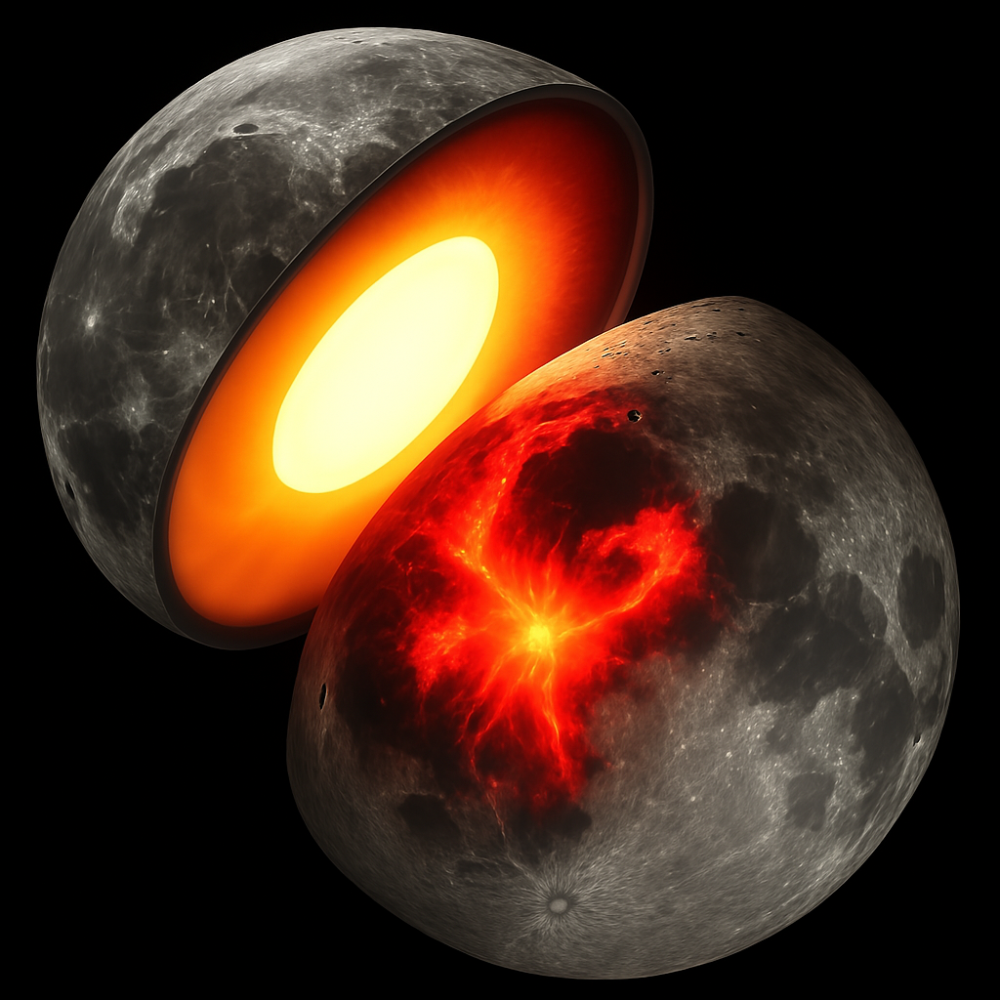
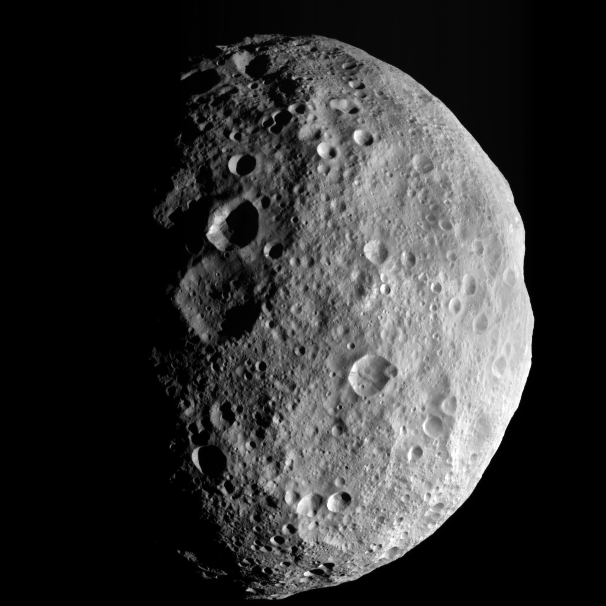
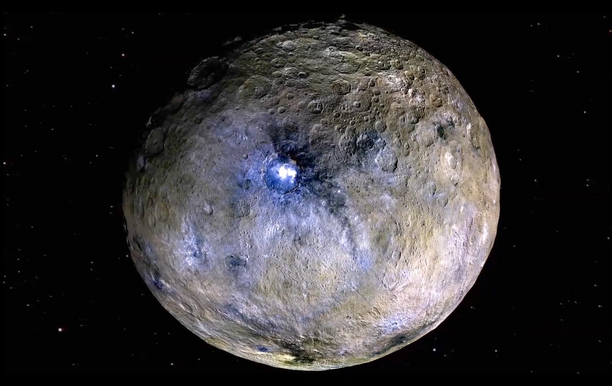
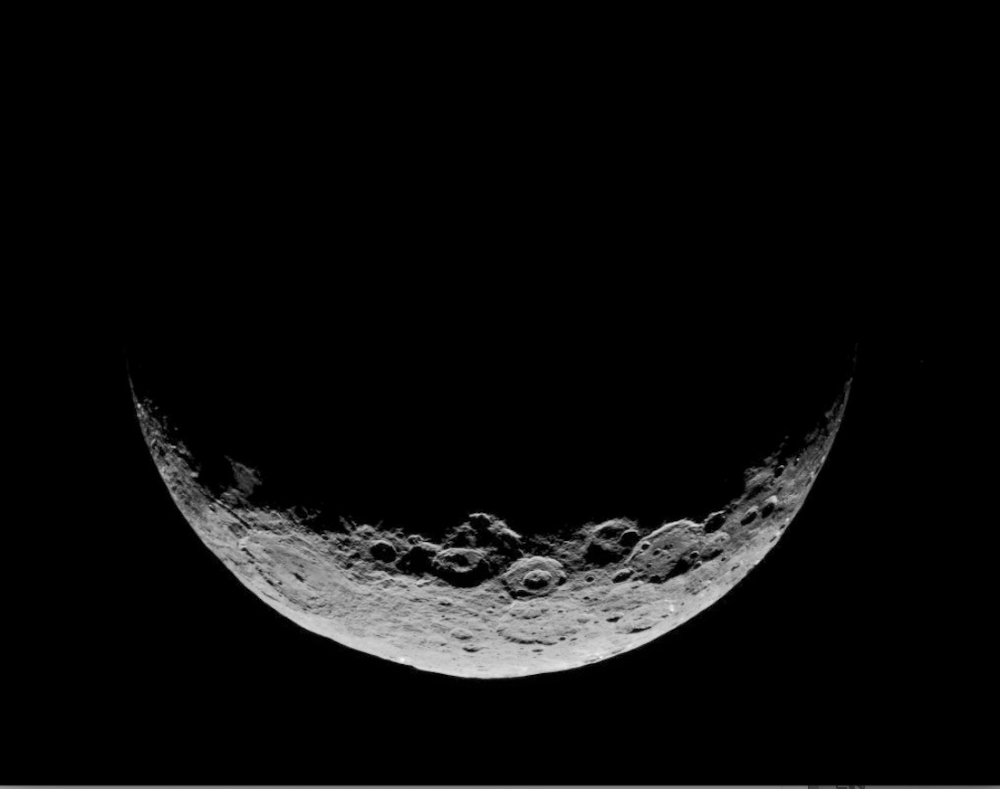

# Dawn Mission: Exploring the Asteroid Belt's Planetary Protoplanets

## Overview & Quick Facts

**Dawn** was NASA’s groundbreaking, first truly interplanetary spaceship. As part of NASA's Discovery Program, Dawn embarked on a journey of over 4.3 billion miles (6.9 billion kilometers) to investigate two of the largest extraterrestrial bodies in the main asteroid belt between Mars and Jupiter: the giant asteroid **Vesta** and the dwarf planet **Ceres**. 

By visiting both primordial bodies, Dawn acted as a cosmic time machine, offering unprecedented insight into the dawn of our solar system and the divergent evolutionary paths of planetary building blocks (protoplanets). Dawn achieved numerous historic firsts, notably becoming the first spacecraft to orbit two separate extraterrestrial destinations beyond Earth and the first to visit a dwarf planet.

| Parameter | Specification |
| :--- | :--- |
| **Mission Type** | Deep-Space Orbiter / Interplanetary Explorer |
| **Target Celestial Bodies** | Asteroid 4 Vesta and Dwarf Planet 1 Ceres |
| **Launch Date** | September 27, 2007 (11:34 UT) |
| **Launch Site** | Cape Canaveral Air Force Station, Space Launch Complex 17B, Florida |
| **Launch Vehicle** | Delta II 7925H-9.5 (Heavy) |
| **Mission Management** | NASA Jet Propulsion Laboratory (JPL) / University of California, Los Angeles (UCLA) |
| **Propulsion System** | Triple Ion Propulsion Engines (Xenon electrostatic ion thrusters) |
| **Vesta Encounter** | July 16, 2011 – September 5, 2012 |
| **Ceres Encounter** | March 6, 2015 – November 1, 2018 |
| **Mission Status** | Completed / Successfully Retired (in stable, permanent graveyard orbit around Ceres) |

---

## Spacecraft Architecture & Innovative Propulsion

*Figure 1: Artist concept depicting the Dawn spacecraft with its expansive 65-foot solar arrays deployed and an ion propulsion thruster firing in deep space.*

Dawn represented a revolution in deep-space navigation, made possible almost entirely by its high-efficiency **ion propulsion system**:
- **Ion Propulsion**: The spacecraft was equipped with three 30 cm (12 in) NSTAR electrostatic xenon ion thrusters derived from the Deep Space 1 technology demonstrator. Ion thrusters ionize xenon gas with electrons and accelerate the ions electrostatically through a pair of grids at exhaust velocities exceeding 30 km/s (67,000 mph). 
- **Efficiency and Velocity Change**: Although each thruster produced a gentle thrust roughly equivalent to the weight of a sheet of paper on the palm of a hand (91 millinewtons), the system operated continuously for thousands of days. Over its lifetime, Dawn accumulated a record-shattering velocity change ($\Delta v$) of more than 11.4 km/s (25,500 mph) purely from its ion engines—far exceeding what any chemical rocket could achieve with equivalent fuel mass.
- **Power Generation**: To power the ion thrusters in the dim sunlight of the asteroid belt (reaching out to 3 astronomical units), Dawn carried two massive 10-panel solar wings spanning 19.7 meters (65 feet) tip-to-tip. At 1 AU (Earth distance), the arrays generated over 10 kW of power, maintaining more than 1.3 kW even at Ceres.
- **Attitude Control**: Reaction wheels and small hydrazine monopropellant reaction-control thrusters maintained precise three-axis pointing for observations and optical navigation.

---

## Scientific Payload & Instruments

Dawn carried three complementary scientific instrument suites designed to map geology, surface elemental abundance, mineralogy, and internal structure:

1. **Framing Camera (FC)**:
   - Contributed by the Max Planck Institute for Solar System Research and the German Aerospace Center (DLR).
   - Consisted of two redundant, high-resolution visual cameras equipped with a clear filter and seven narrow-band spectral filters spanning 450 to 980 nm.
   - Captured high-resolution topographic maps, stereoscopic imaging, and optical navigation tracking.
2. **Visible and Infrared Spectrometer (VIR)**:
   - Provided by the Italian Space Agency (ASI) and the Italian National Institute for Astrophysics (INAF).
   - Operating across visual and near-infrared wavelengths (0.25 to 5.0 $\mu$m), VIR mapped mineral composition, identifying pyroxenes on Vesta and ammoniated phyllosilicates, carbonates, and water ice on Ceres.
3. **Gamma Ray and Neutron Detector (GRaND)**:
   - Developed by the Los Alamos National Laboratory and operated by the Planetary Science Institute (PSI).
   - Measured cosmic-ray-induced gamma rays and neutrons emanating from the top 1 meter of regolith to quantify elemental concentrations of iron, magnesium, silicon, oxygen, potassium, hydrogen (water equivalent), and thorium.
4. **Gravity Science Investigation**:
   - Exploited the spacecraft’s X-band radio communications system and NASA’s Deep Space Network (DSN) to measure minuscule Doppler shifts, constructing detailed spherical harmonic gravity field maps of both bodies.

---

## Scientific Discoveries: Vesta vs. Ceres

*Figure 2: Cross-sectional comparisons illustrating the differentiated, rocky interior of asteroid Vesta alongside the Earth's Moon.*

Dawn unveiled two drastically different planetary worlds that formed in the same cosmic neighborhood:

### 1. Asteroid 4 Vesta: A Dry, Differentiated Protoplanet
Vesta is an intact, differentiated proto-planet that preserved the conditions of the early inner solar system before planets finished forming:
- **Core and Crustal Differentiation**: Gravity and spectral measurements confirmed that Vesta has an iron-nickel metal core roughly 210 to 226 km across, an olivine-rich silicate mantle, and a basaltic volcanic crust, strikingly similar to the terrestrial planets and the Moon.
- **Massive Impact Basins**: Dawn revealed two colossal overlapping impact basins at Vesta's south pole: **Rheasilvia** (500 km across, featuring a central peak rising 22 km—nearly three times the height of Mount Everest) and the older **Veneneia** basin. These cataclysms excavated deep crustal rocks and blasted fragments across the solar system, confirming Vesta as the parent body of the HED (Howardite-Eucrite-Diogenite) meteorites found on Earth.
- **Surface Gullies & Volatiles**:
  
  
  *Figure 3: High-resolution Framing Camera view (PIA15675) showing narrow gullies cut into impact crater slopes on giant asteroid Vesta, indicating localized volatile releases or dry fluidized granular flows.*

### 2. Dwarf Planet 1 Ceres: An Evolving, Water-Rich World

*Figure 4: Global enhanced-color view of dwarf planet Ceres captured by Dawn (PIA20182), showing widespread impact cratering, crustal variations, and localized bright faculae.*

Upon reaching Ceres in March 2015, Dawn revealed a vastly different world: a volatile-rich dwarf planet dominated by salts, ice, and hydrated clays:
- **Occator Crater and the Bright Faculae**:
  
  
  *Figure 5: High-resolution detail of Cerealia and Vinalia Faculae in Occator Crater (PIA21407-Fig1), revealing massive sodium carbonate deposits formed by hydrothermal brine upwelling.*
  
  Dawn identified intense bright spots across Ceres, predominantly within **Occator Crater** (the central *Cerealia Facula* and secondary *Vinalia Faculae*). VIR and FC data proved these bright spots are the largest deposits of sodium carbonate ($Na_2CO_3$) discovered outside of Earth, along with ammonium chloride and sodium bicarbonate.
- **Cryovolcanism & Subsurface Brine Reservoir**:
  Ceres possesses an ice-rich crust (~30–40% ice by volume) and an ancient, deep-seated regional reservoir of subterranean liquid brine. Impacts like the one that created Occator Crater fractured the crust, allowing thermal energy from the core and impact melt to drive cryomagma and brines to the surface over tens of millions of years.
- **Ahuna Mons**: Dawn imaged Ahuna Mons, a solitary 4,000-meter-tall dome-shaped cryovolcanic mountain formed by the extrusion of viscous, salt-rich ice and mud slurry.
- **Organic Molecules**: VIR detected native aliphatic organic molecules in the Ernutet crater region, indicating Ceres harbored water, heat, minerals, and organic building blocks—key ingredients for habitability in early solar system history.

---

## Mission Timeline & End of Mission

- **Sept. 27, 2007**: Launch from Cape Canaveral.
- **Feb. 17, 2009**: Mars gravity assist (closest approach 549 km) giving a 9,300 km/h velocity boost.
- **July 16, 2011**: Orbital insertion at Vesta. Conducted Survey, High-Altitude Mapping (HAMO), and Low-Altitude Mapping (LAMO) orbits.
- **Sept. 5, 2012**: Departed Vesta orbit using ion propulsion, becoming the first spacecraft to leave the orbit of another celestial body for a second planetary destination.
- **March 6, 2015**: Captured by Ceres' gravity, entering orbit around the dwarf planet.
- **2015–2018**: Multiple mapping phases, descending to an ultra-low orbit just 35 kilometers (22 miles) above the surface in mid-2018.
- **Nov. 1, 2018**: After completely exhausting its remaining hydrazine attitude control propellant, communications ceased. To satisfy strict planetary protection protocols ensuring Ceres' potential prebiotic environment remains uncontaminated, Dawn was placed into a safe, permanent gravitational orbit where it will quietly circle Ceres for decades or centuries.
