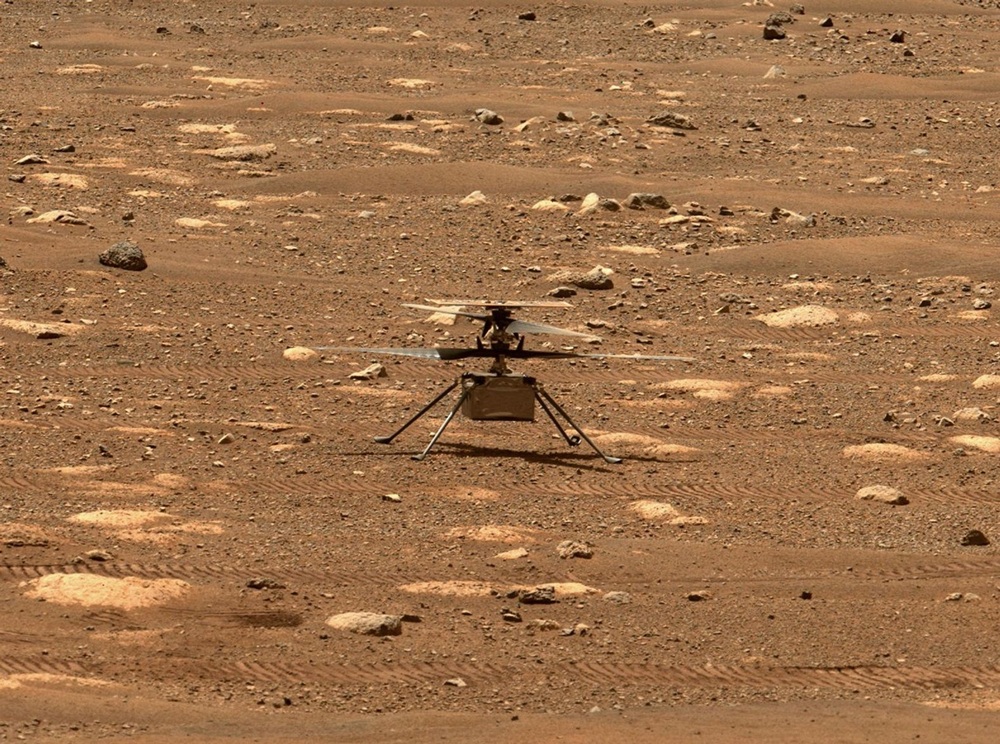
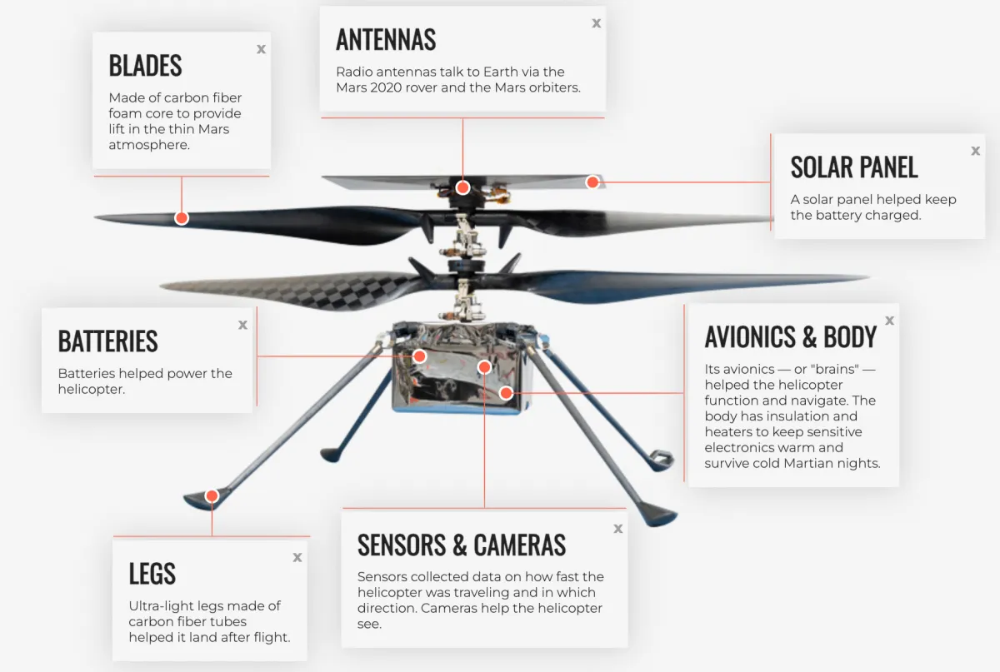
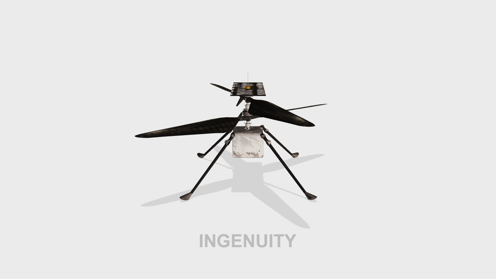
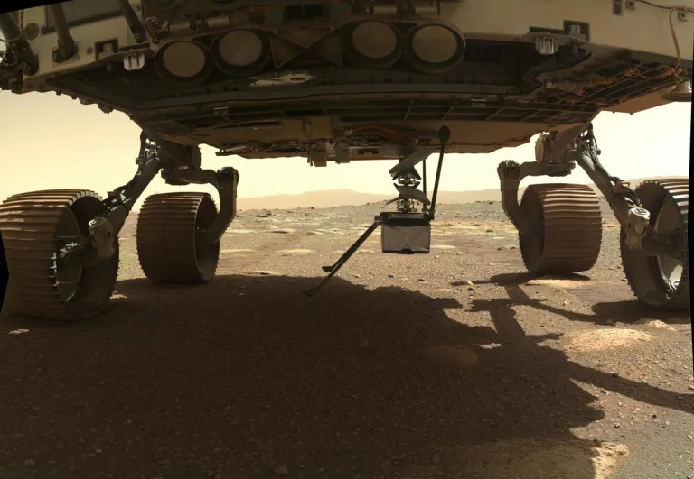
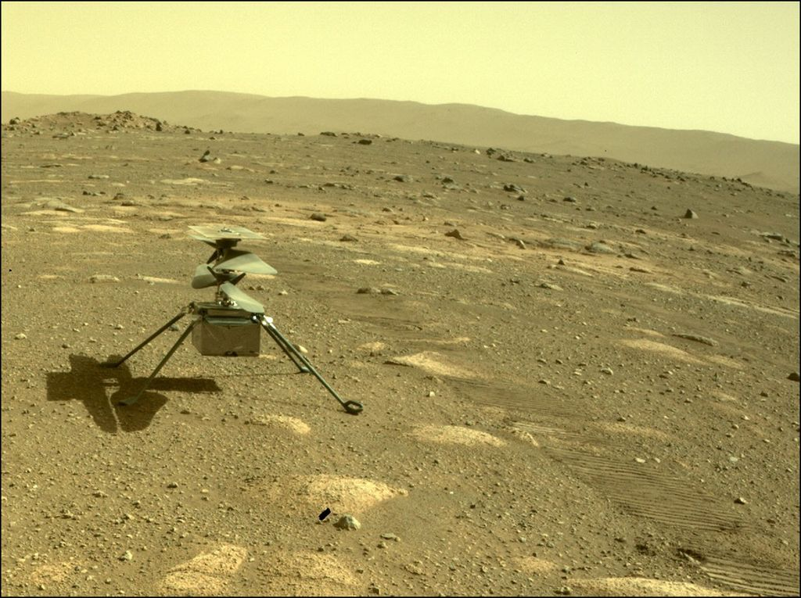
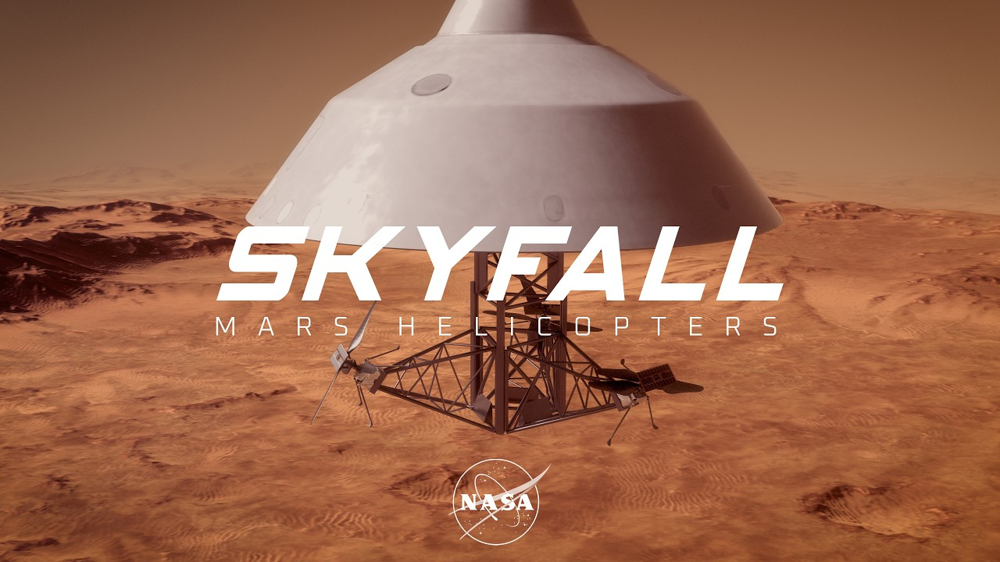
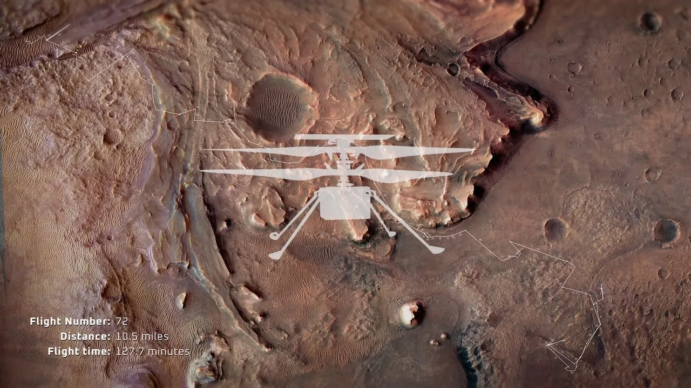
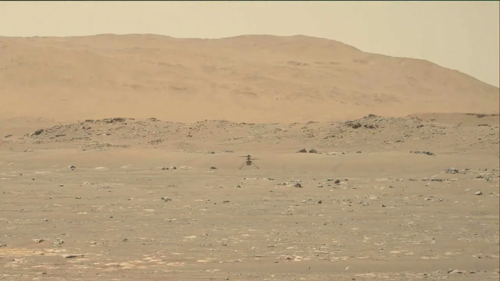

# Ingenuity Mars Helicopter: The Wright Brothers Moment on the Red Planet


*Figure 1: NASA’s Ingenuity Mars Helicopter captured soaring above the Martian regolith during an aerial scout mission across Jezero Crater.*

## Overview & Quick Facts

The **Ingenuity Mars Helicopter** was a historic, pioneering rotorcraft developed by NASA’s Jet Propulsion Laboratory (JPL) that achieved the first powered, controlled aerodynamic flight on another planet. Arriving on Mars tucked safely beneath the belly of the Mars 2020 **Perseverance rover**, Ingenuity was initially conceived as a high-risk, high-reward technology demonstration scheduled for no more than 5 short flights across 30 Martian days (sols).

Exceeding every engineering expectation by orders of magnitude, Ingenuity survived nearly three years on Mars, successfully completing **72 flights**, traveling over 17 kilometers (10.5 miles), and logging more than two hours of cumulative flight time. It transitioned from a basic experimental flight testbed into an active operational scout and forward reconnaissance asset for Perseverance, rewriting the playbook for planetary exploration.

| Parameter | Specification |
| :--- | :--- |
| **Mission Type** | Autonomous Planetary Rotorcraft / Aerial Technology & Operations Demo |
| **Destination** | Jezero Crater, Mars (18.38° N, 77.58° E) |
| **Launch Date** | July 30, 2020 (11:50 UT) |
| **Launch Vehicle** | Atlas V 541 (Mars 2020 Mission) |
| **Landed on Mars** | February 18, 2021 (deployed to surface April 3, 2021) |
| **First Flight Date** | April 19, 2021 (Sol 58) |
| **Final Flight Date** | January 18, 2024 (Flight 72, Sol 1035) |
| **Mission Completed** | January 25, 2024 (following rotor tip damage) |
| **Total Completed Flights**| **72 Historic Flights** |
| **Total Flight Distance** | 17.2 km (10.7 miles) |
| **Total Flight Duration** | 128.8 minutes (2 hours, 8 minutes, 48 seconds) |
| **Maximum Altitude Reached**| 24.0 meters (78.7 feet) |
| **Maximum Ground Speed** | 10.0 m/s (22.4 mph / 36 km/h) |

---

## Anatomy & Engineering Architecture


*Figure 2: Cutaway anatomical breakdown of the Ingenuity Mars Helicopter, highlighting its counter-rotating rotors, solar array, battery pack, and avionics cube.*

Flying on Mars presents formidable physical challenges: the Martian atmospheric density is less than **1% of Earth's** at sea level (roughly equivalent to flying at 100,000 feet / 30,000 meters altitude on Earth). To produce sufficient aerodynamic lift in such tenuous carbon dioxide air, Ingenuity required radical engineering:


*Figure 3: Technical dimensional blueprint and physical layout of the Ingenuity Mars Helicopter.*

- **Mass & Dimensions**: The total mass of the helicopter was only **1.8 kilograms (4.0 pounds)** on Earth, weighing just 0.68 kg (1.5 lbs) in Mars' lower gravity ($0.38g$). Its total height was 0.49 meters (1.6 ft).
- **Coaxial Carbon-Fiber Rotors**: Two counter-rotating, coaxial rotor systems spanning **1.21 meters (4 feet)** in diameter were constructed with lightweight carbon-fiber composite cores and foam filling. To generate lift, the blades spun between **2,400 and 2,700 revolutions per minute (RPM)**—roughly 5 to 10 times faster than an Earth passenger helicopter.
- **Power Subsystem**: A small rectangular solar panel mounted directly atop the rotor assembly charged six Sony lithium-ion batteries with an energy capacity of approximately 35–43 watt-hours. Two-thirds of this stored energy was consumed every Martian night by internal electric heaters to prevent sensitive electronics and battery cells from freezing in temperatures that plummet to $-90^\circ	ext{C}$ ($-130^\circ	ext{F}$).
- **Autonomous Flight Avionics**: Because radio signals between Earth and Mars take anywhere from 5 to 20 minutes each way, real-time joystick control was physically impossible. Ingenuity was fully autonomous during flight:
  - Powered by a Qualcomm Snapdragon 801 processor running an open-source Linux operating system with JPL's F Prime ($F'$) flight software framework.
  - A downward-facing, high-speed black-and-white visual odometry navigation camera (VNAV) captured 30 images per second of the ground texture, which were processed instantly alongside high-rate IMU and laser altimeter readings to estimate velocity, altitude, and drift.
  - A horizon-facing 13-megapixel Sony color terrain camera captured rich aerial photography of the Martian surface.
- **Wright Brothers Tribute**: Attached beneath the solar panel was a tiny postage-stamp-sized swatch of muslin fabric from the wing of the 1903 *Wright Flyer*, honoring the first human-powered flight on Earth.

---

## Deployment & Early Milestones


*Figure 4: Ingenuity rotated outward from its horizontal stowage position on the belly of Perseverance into a vertical orientation prior to touchdown (PIA24443).*

1. **Stowage and Transit**: Ingenuity was folded horizontally under the belly pan of Perseverance, protected by a debris shield during the Mars atmospheric entry, descent, and landing on Feb. 18, 2021.
2. **Surface Release ("Four Feet on Mars")**: On April 3, 2021, the rover's deployment mechanism dropped Ingenuity the final 4 inches (10 cm) onto the surface of "Wright Brothers Field" in Jezero Crater.
3. **Surviving the Frigid Night**: On April 4, 2021, Ingenuity survived its first night disconnected from Perseverance's nuclear power source, relying solely on its internal solar-charged batteries.
4. **First Historic Flight (April 19, 2021)**: Ingenuity spun its blades to 2,500 RPM, ascended vertically to 3 meters (10 feet), hovered steadily for 30 seconds, rotated 96 degrees, and touched down cleanly after 39.1 seconds of flight.


*Figure 5: Ingenuity standing solitary on its four carbon-composite legs on the rocky surface of Jezero Crater (PIA24541).*

---

## Evolution Through Mission Phases

```
   +-----------------------------------------------------------------------+
   |                        INGENUITY MISSION PHASES                       |
   +-----------------------------------------------------------------------+
        |
        +--> Phase 1: Technology Demonstration (Flights 1 - 5)
        |    - Objective: Prove powered aerodynamic flight on Mars
        |    - Duration: 30 sols (April - May 2021)
        |    - Milestones: First flight, forward horizontal translation,
        |                  one-way flight to new airfield.
        |
        +--> Phase 2: Operations Demonstration & Aerial Scout (Flights 6 - 57)
        |    - Objective: Serve as an aerial scout for Perseverance Rover
        |    - Achievements: Imaged rover traverse corridors, scouted delta
        |                    rock formations, evaluated safe routes through
        |                    treacherous sand ripples ("Séítah" region).
        |    - Aerial Inspection: Photographed Perseverance's discarded
        |                         backshell and parachute from 8 meters height.
        |
        +--> Phase 3: Advanced Engineering Flight Envelope Expansion (Flights 58 - 72)
             - Objective: Push aerodynamic, sensor, and velocity limits
             - Record Speeds & Altitudes: 10 m/s (22.4 mph) and 24 m altitude
             - Cold-Weather Survival: Adapted to Martian winter low air densities
             - Flight 72 (Jan 18, 2024): Hard landing on featureless sandy terrain
               resulted in rotor blade tip damage, gracefully concluding operations.
```

---

## Media & Visual Legacy

````carousel

<!-- slide -->

<!-- slide -->

<!-- slide -->

````
*Figure 6: Featured video retrospectives and mission milestone captures documenting the helicopter's transition from technology demonstrator to active planetary scout.*

Ingenuity's remarkable run fundamentally proved that aerial exploration is viable on other planets. Its data and lessons learned now directly inform future aerial missions, such as the upcoming **Dragonfly** rotorcraft lander to Saturn's moon Titan and proposed next-generation Mars sample retrieval helicopters.
