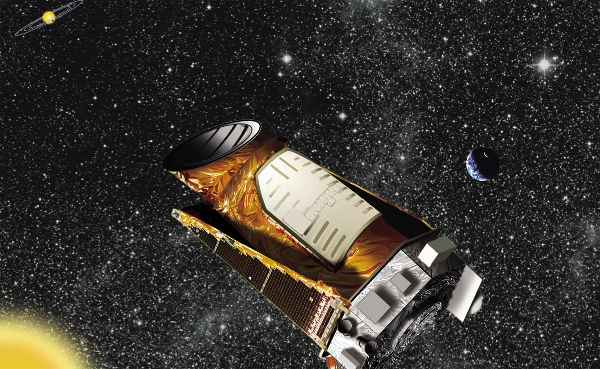
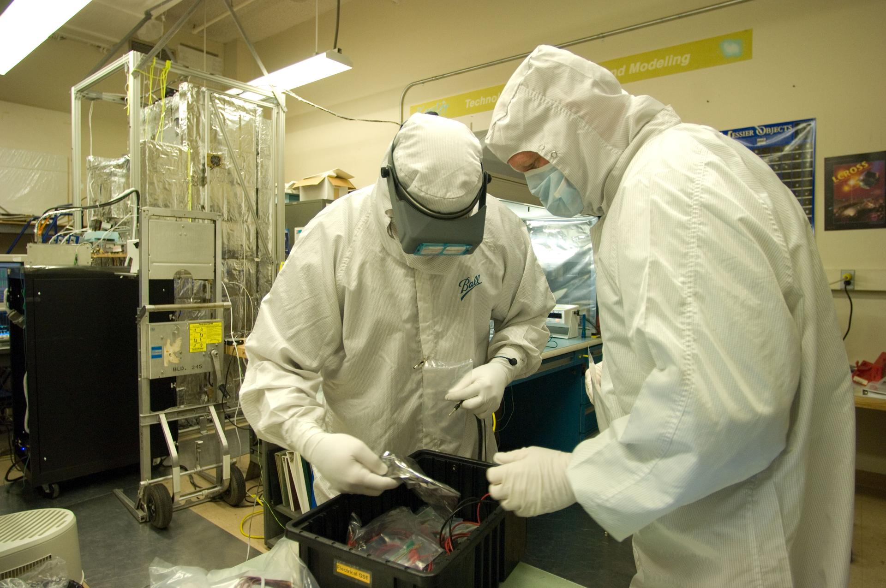
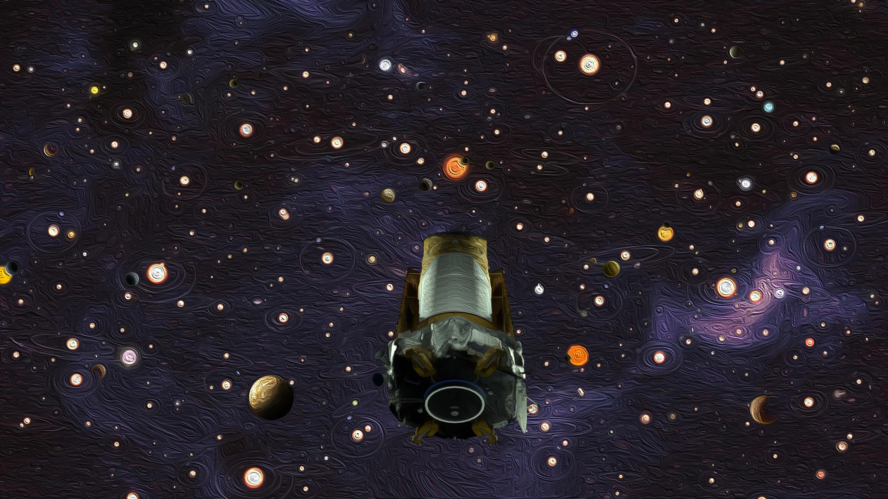
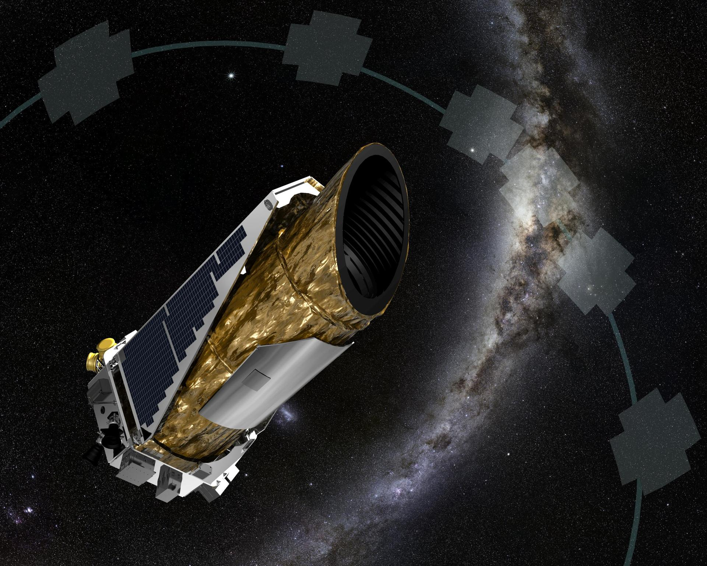
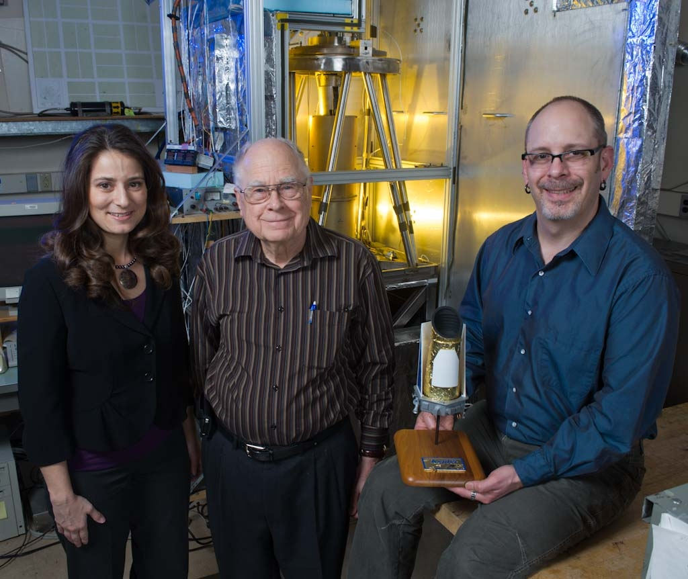
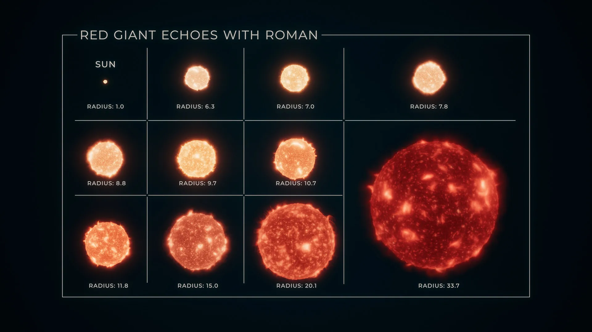
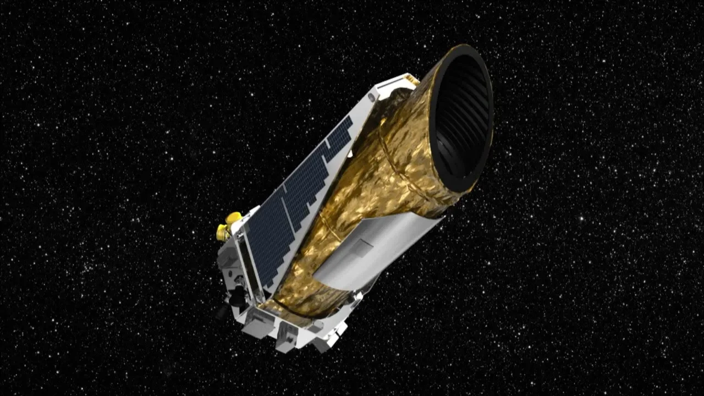

# Kepler & K2 Space Telescope: Revealing Billions of Exoplanets in Our Galaxy

*Figure 1: Artist concept of NASA's planet-hunting Kepler space telescope operating in deep space, staring intently into the star-studded fields of the Milky Way.*

## Overview & Quick Facts

The **Kepler Space Telescope** (NASA Discovery Program Mission 10) was humanity’s first dedicated mission designed to search for Earth-sized and smaller rocky planets orbiting other stars within the habitable zone ("Goldilocks zone") where liquid water could pool on a planet's surface. 

During nine years of deep-space operations—encompassing its prime mission and its ingeniously resurrected second mission dubbed **K2**—Kepler revolutionized humanity’s understanding of our place in the universe. Kepler proved that planets outnumber stars in our Milky Way galaxy, discovering over **2,600 confirmed exoplanets** and cataloging thousands more planet candidates.

| Parameter | Specification |
| :--- | :--- |
| **Mission Type** | Space Photometry Observatory / Exoplanet Transit Hunter |
| **Orbit** | Earth-trailing Heliocentric Orbit (372.5-day period) |
| **Launch Date** | March 6, 2009 (22:49 EST / March 7 03:49 UT) |
| **Launch Site** | Cape Canaveral Air Force Station, Space Launch Complex 17B, Florida |
| **Launch Vehicle** | Delta II 7925-10L |
| **Primary Mission** | March 2009 – May 2013 (Fixed staring at Cygnus & Lyra) |
| **Extended Mission (K2)** | May 2014 – October 2018 (Ecliptic campaigns steered by sunlight) |
| **Decommissioning Date** | October 30, 2018 (retired in safe, drift-away heliocentric orbit) |
| **Primary Mirror Diameter**| 1.4 meters (4 feet, 7 inches) |
| **Telescope Aperture** | 0.95 meters (3 feet, 1 inch) Schmidt telescope |
| **Focal Plane Array** | 42 CCD image sensors (95 megapixels; largest digital camera flown in space at launch) |
| **Confirmed Exoplanets** | **2,662+ Confirmed Planets** (out of 6,000+ known exoplanets today) |
| **Stars Surveyed** | Over 530,000 stars across both mission phases |

---

## Spacecraft Architecture & Detection Method

*Figure 2: The Kepler Schmidt telescope optics and photometer assembly undergo calibration and cleanroom integration prior to launch.*

### The Transit Photometry Method
Kepler detected exoplanets using **transit photometry**:
- When a planet crosses (transits) directly in front of its parent star along the telescope's line of sight, it blocks an infinitesimal fraction of the star's light.
- For a Jupiter-sized planet, this brightness dip is roughly 1%.
- For an Earth-sized planet passing across a Sun-like star, the dip is a mere **84 parts per million** (0.0084%), equivalent to spotting a gnat crawling across a car headlight miles away.
- Kepler was engineered with ultra-high photometric precision capable of detecting brightness variations as tiny as 20 parts per million.

*Figure 3: Technicians inspect Kepler inside the cleanroom facility at Astrotech Space Operations, Titusville, Florida.*

### Spacecraft Design
Kepler was essentially a massive optical camera with a spacecraft bus built around it:
- **Schmidt Optics**: A 0.95 m fused-silica Schmidt corrector plate and a 1.4 m ultra-low-expansion glass primary mirror.
- **Focal Plane Array**: 42 charge-coupled devices (CCDs) measuring 50 × 25 mm each, creating a total resolution of 95 megapixels. The array was curved to match the Schmidt focal surface.
- **Field of View**: A vast 115-square-degree field of view (equivalent to two open human hands held at arm's length), allowing Kepler to continuously stare at approximately 150,000 main-sequence stars simultaneously.

---

## The Prime Mission vs. The K2 Resurrection

*Figure 4: The 115-square-degree primary search field in the northern constellations Cygnus and Lyra, targeting over 150,000 stars continuously.*

### Prime Mission (2009–2013)
Kepler was pointed toward a fixed, star-dense region of the Milky Way in the northern constellations **Cygnus and Lyra**, unobstructed by the Sun or Moon:
- For over four years, Kepler recorded light measurements every 30 minutes for 150,000 target stars.
- It unveiled entire compact, multi-planet systems (e.g., Kepler-11, Kepler-20, Kepler-90) and rocky worlds orbiting in habitable zones.

### Reaction Wheel Failures & The "Kayak" Solar Fix (K2)

*Figure 5: Artist concept (PIA18904) illustrating Kepler's K2 mission geometry, where solar radiation pressure against the solar panels was used to stabilize the telescope.*

In July 2012, Reaction Wheel 2 failed; in May 2013, Reaction Wheel 4 failed. With only two working reaction wheels, Kepler could no longer maintain the three-axis pinpoint pointing required to stare at its original field:
- **The Ingenious Solar Fix**: Ball Aerospace and NASA engineers designed an unprecedented stabilization method. By aligning the spacecraft so its solar panels were oriented symmetrically toward the Sun, the gentle, uniform pressure of sunlight (solar photon pressure) acted as a virtual third reaction wheel—like a kayak balanced in a flowing river current.
- **The K2 Mission (2014–2018)**: Steered by sunlight and two reaction wheels, the reborn mission—**K2**—conducted 19 distinct 80-day observing "campaigns" distributed along the ecliptic plane. K2 observed over 500,000 stars, exploding supernovae, young star-forming clusters (Pleiades and Hyades), asteroids, comets, and active galactic nuclei.

---

## Discoveries, Habitable Zones & Planetary Diversity

*Figure 6: Planet candidates discovered by Kepler arranged by orbital period and planet size, demonstrating the abundance of Super-Earths and sub-Neptunes.*

*Figure 7: An artistic representation of the staggering diversity of worlds discovered by Kepler.*

### Fundamental Scientific Revelations:
1. **Planets Outnumber Stars**: Kepler conclusively established that nearly every star in the Milky Way hosts at least one planet.
2. **Prevalence of Habitable Earth-Sized Worlds**: Statistical analysis of Kepler data reveals that **20% to 50%** of stars visible in the night sky possess small, rocky Earth-sized planets within their habitable zones where liquid water could exist.
3. **The "Missing" Planetary Types**: Kepler found that the most common types of planets in our galaxy are **Super-Earths** (planets with 1.2 to 2 Earth radii) and **Sub-Neptunes** (2 to 4 Earth radii)—planetary classes completely absent from our own solar system.
4. **Circumbinary Planets ("Tatooine" Worlds)**: Kepler confirmed the existence of planets orbiting two stars simultaneously (such as Kepler-16b).

---

## Mission Retirement & Legacy

*Figure 8: Documentary retrospective on the scientific revolution sparked by the Kepler Space Telescope.*

By mid-2018, telemetry revealed that Kepler’s hydrazine fuel was nearly exhausted. Engineers successfully prioritized downlink of Campaign 19 science data before the thrusters lost pressure. On **October 30, 2018**, NASA commanded Kepler’s transmitters to turn off, leaving the spacecraft in a stable, heliocentric orbit trailing Earth. 

Kepler established the foundation for modern exoplanet astronomy, directly setting the stage for NASA's **TESS** (Transiting Exoplanet Survey Satellite), the **James Webb Space Telescope (JWST)**, the **ESA Ariel mission**, and the upcoming **Nancy Grace Roman Space Telescope**.
