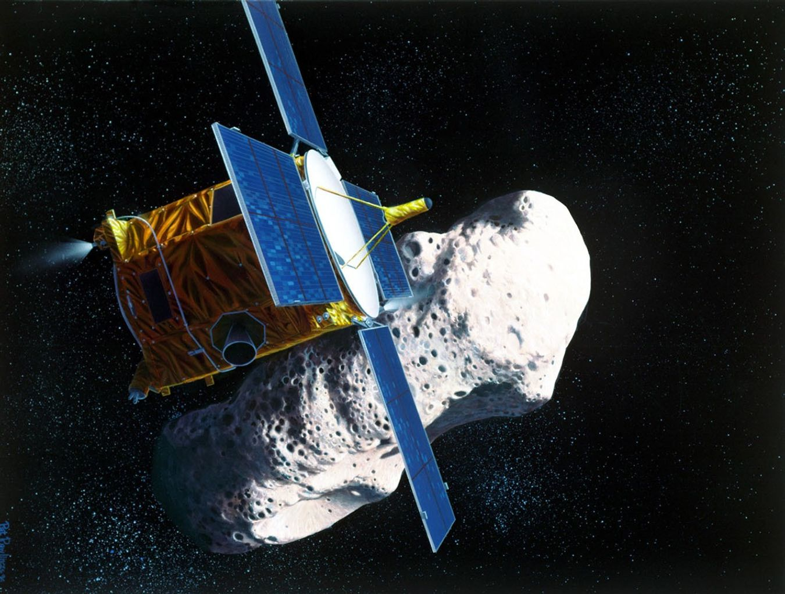
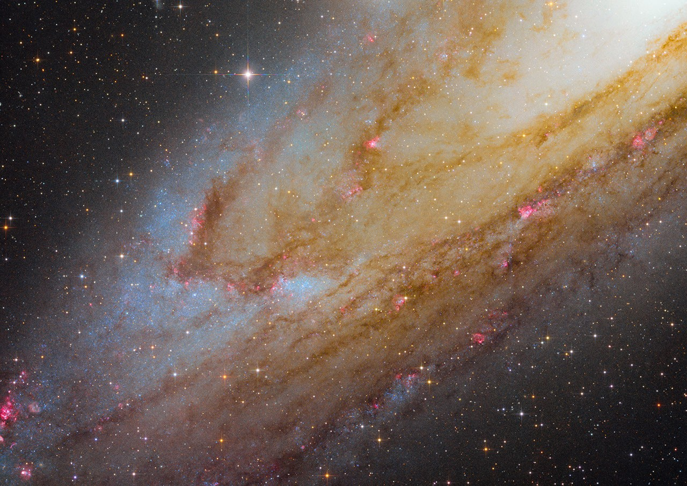
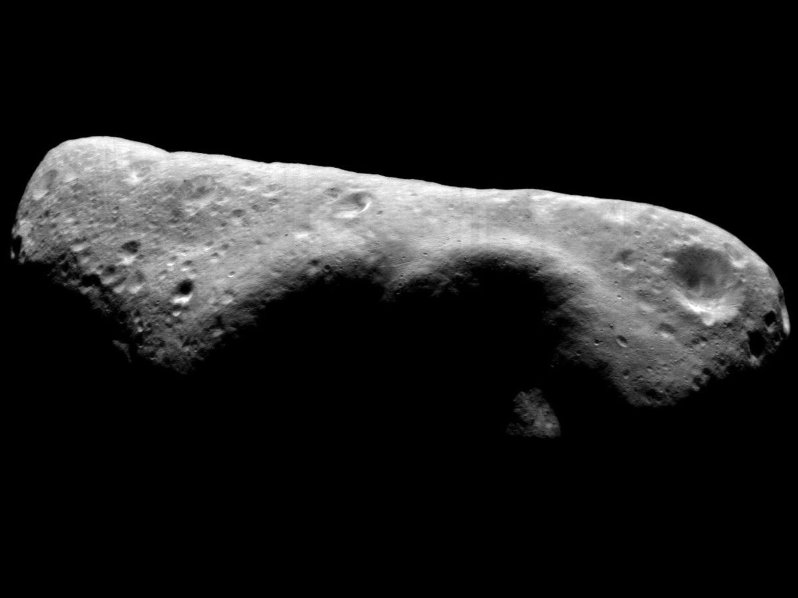

# NEAR Shoemaker: The First Robotic Explorer to Orbit and Land on an Asteroid

*Figure 1: Artist illustration of NASA’s NEAR Shoemaker spacecraft surveying the rugged, cratered surface of near-Earth asteroid 433 Eros.*

## Overview & Quick Facts

**NEAR Shoemaker** (Near Earth Asteroid Rendezvous), renamed in March 2000 in honor of the pioneering planetary geologist **Dr. Eugene M. Shoemaker** (1928–1997), was the very first mission launched under NASA’s **Discovery Program**—a series of low-cost, focused planetary science missions led by a Principal Investigator. 

Designed and managed by the Johns Hopkins University Applied Physics Laboratory (JHU/APL), NEAR achieved historic milestones in space exploration: it became the **first human-made spacecraft to orbit an asteroid** and subsequently the **first spacecraft to ever land on an asteroid**. Remarkably, although NEAR was never designed as a lander, it executed a soft touchdown on the boulder-strewn surface of near-Earth asteroid **433 Eros** on February 12, 2001, surviving impact and returning groundbreaking scientific data for over two weeks from the surface.

| Parameter | Specification |
| :--- | :--- |
| **Mission Type** | Asteroid Flyby, Orbiter, and Controlled Lander |
| **Primary Target** | Near-Earth Asteroid 433 Eros (S-type asteroid) |
| **Secondary Target** | Asteroid 253 Mathilde (C-type asteroid flyby) |
| **Launch Date** | February 17, 1996 (20:43:27 UT) |
| **Launch Vehicle** | Delta II 7925-8 (no. D232) |
| **Launch Site** | Cape Canaveral Air Force Station, Launch Complex 17B, Florida |
| **Mission Management** | NASA Goddard Space Flight Center (GSFC) / Johns Hopkins Applied Physics Lab (JHU/APL) |
| **Total Spacecraft Mass** | 1,775 lbs (805 kg) wet; 1,074 lbs (487 kg) dry |
| **Power System** | Four fixed GaAs solar panels (first solar-powered mission beyond Mars orbit, 2.2 AU) |
| **Mathilde Flyby** | June 27, 1997 (closest approach 1,200 km / 750 miles) |
| **Earth Gravity Assist** | January 23, 1998 (closest approach 540 km / 335 miles) |
| **Eros Orbit Insertion** | February 14, 2000 (00:33 UT) |
| **Controlled Landing on Eros**| February 12, 2001 (20:01:52 UT) |
| **Last Contact with Spacecraft**| February 28, 2001 (succumbed to extreme cryogenic night on Eros) |

---

## Spacecraft Architecture & Technical Subsystems

*Figure 2: Rendering of the NEAR Shoemaker spacecraft showcasing its compact bus, X-band high-gain dish antenna, and four solar wings.*

The NEAR spacecraft featured an octagonal prism architecture built for simplicity, high structural rigidity, and autonomous operation:
- **Structure**: Aluminum honeycomb panels forming a 1.7-meter-wide octagonal frame.
- **Solar Power**: Four fixed gallium arsenide (GaAs) solar panels provided 1,800 W at 1 AU and roughly 324 W at its furthest orbital distance from the Sun (2.2 AU). This made NEAR the first spacecraft to operate entirely on solar photovoltaic power beyond the orbit of Mars.
- **Propulsion System**: A dual-mode propulsion system consisting of a 450-newton (100 lbf) hydrazine/nitrogen tetroxide main thruster for large $\Delta v$ orbital maneuvers, alongside eleven 3.5-newton and four 21-newton monopropellant hydrazine thrusters for attitude control and fine orbital trims.
- **Telecommunications**: A 1.5-meter fixed parabolic high-gain dish antenna, two medium-gain horn antennas, and omnidirectional low-gain antennas operating in X-band for Deep Space Network communications.

---

## Scientific Payload & Instruments

NEAR carried six advanced scientific instruments mounted to a single fixed instrument deck:

1. **Multi-Spectral Imager (MSI)**:
   - High-resolution visual CCD camera with an 8-position filter wheel (450 to 1,050 nm) for surface morphology, crater counting, and compositional mapping.
2. **Near-Infrared Spectrometer (NIS)**:
   - Measured reflected sunlight between 800 and 2,500 nm to determine the mineral composition of Eros (pyroxene, olivine, and plagioclase).
3. **X-Ray / Gamma-Ray Spectrometer (XGRS)**:
   - Identified elemental abundances of iron, magnesium, silicon, potassium, aluminum, and oxygen by measuring solar-excited fluorescent X-rays and cosmic-ray-induced gamma emissions.
4. **NEAR Laser Rangefinder (NLR)**:
   - Diode-pumped Nd:YAG laser altimeter measuring precise topographic distances down to 30 cm, generating an exact 3D shape model and elevation grid of Eros.
5. **Magnetometer (MAG)**:
   - Triaxial fluxgate magnetometer to detect any intrinsic magnetic dipole or induced magnetic fields.
6. **Radio Science & Gravimetry Experiment**:
   - Monitored X-band Doppler carrier shifts to compute the gravitational mass, density distribution, and center of mass of Eros.

---

## Flight Profile & The Road to Eros

### 1. The Mathilde Encounter (June 27, 1997)
En route to Eros, NEAR conducted a high-speed flyby of the C-type asteroid **253 Mathilde** at a range of 1,200 km (750 miles). Over 25 minutes, MSI imaged 60% of Mathilde, uncovering an intensely cratered "rubble pile" world with an unexpectedly low bulk density ($1.3	ext{ g/cm}^3$, roughly half that of typical rock), demonstrating remarkable internal porosity.

### 2. Earth Flyby & The Trajectory Glitch (1998)
On January 23, 1998, NEAR flew past Earth for a gravity assist. However, on December 20, 1998, during a critical main engine burn scheduled to decelerate the spacecraft for Eros rendezvous, an attitude control abort caused the engine to shut down early. NEAR tumbled into a safe-mode state, temporarily losing contact for 27 hours. Flight controllers rapidly designed a backup trajectory, performing a flyby of Eros on Dec. 23, 1998 (at 3,827 km), which collected preliminary imagery and established an orbit insertion date of February 14, 2000 (Valentine's Day).

---

## Discoveries at Asteroid 433 Eros & The Historic Landing

*Figure 3: Close-up photograph of asteroid 433 Eros obtained by NEAR's Multi-Spectral Imager, revealing vast boulder fields, impact craters, and smooth regolith ponds.*

*Figure 4: Image mosaic of Eros' southern hemisphere offering a long-distance view of the cratered terrain.*

On February 14, 2000, NEAR entered orbit around 433 Eros, becoming the first spacecraft to orbit a minor planet. Over a year-long orbital campaign, NEAR gradually lowered its orbit from 320 km down to just 24 km above the surface:
- **Physical Characteristics of Eros**: Eros is a heavily cratered, peanut-shaped S-type asteroid measuring **33 × 13 × 13 kilometers (21 × 8 × 8 miles)** with an average density of $2.67	ext{ g/cm}^3$—remarkably uniform throughout its volume and very similar to Earth's continental crust.
- **Undifferentiated Primitive Body**: Spectrometry proved that Eros is an undifferentiated, primitive body—a direct cosmic relative of ordinary chondrite meteorites. Unlike Vesta, it never melted into a distinct core, mantle, and crust.
- **Boulders and "Regolith Ponds"**: NEAR observed thousands of massive boulders (up to 100 meters across) and discovered flat, dust-filled "ponds" inside craters where electrostatic levitation and acoustic shaking caused fine dust particles to settle like lakes.
- **Magnetic Field**: The magnetometer confirmed that Eros possesses **no detectable intrinsic magnetic field**.

### The Unprecedented Landing (Feb. 12, 2001)
At the conclusion of its orbital mission, engineers decided to attempt a historic controlled descent:
- Maneuvering thrusters slowed NEAR’s descent from orbit down to a gentle terminal velocity of **1.5 to 1.8 meters per second (3.4 to 4 mph)**.
- At 20:01:52 UT on February 12, 2001, NEAR touched down safely on the south edge of the saddle-shaped depression named Himeros.
- Surviving touchdown with zero damage, NEAR continued transmitting telemetry and Gamma-Ray Spectrometer data directly from the surface until February 28, 2001, providing the first in-situ elemental analysis of an asteroid's surface.
