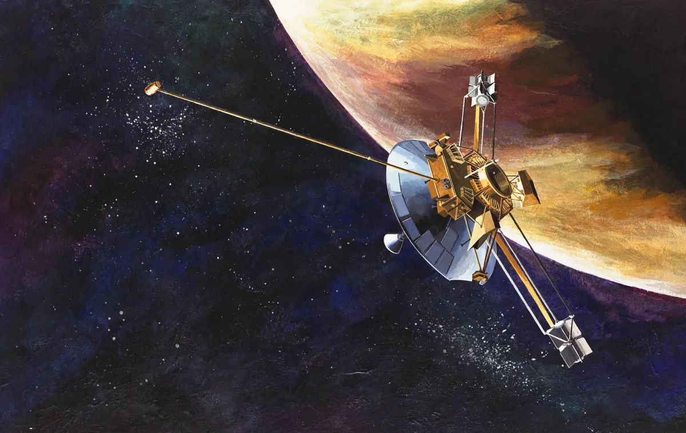
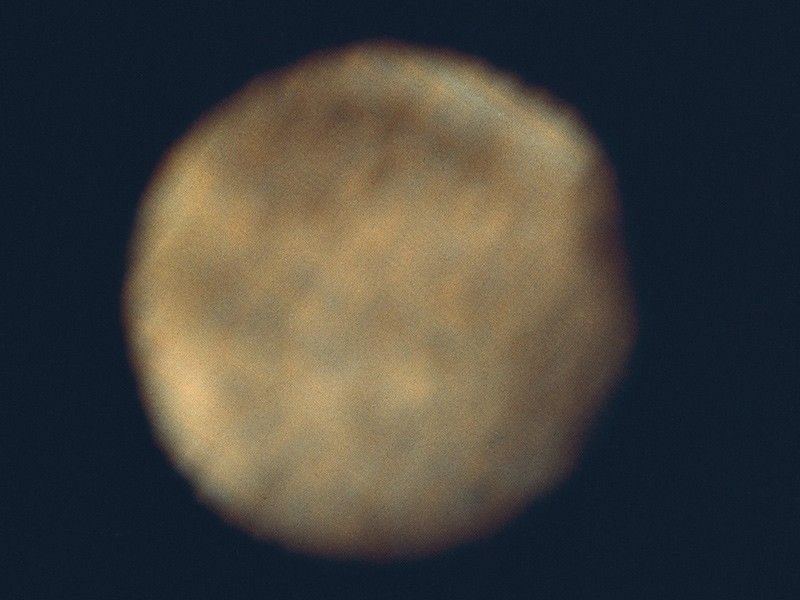
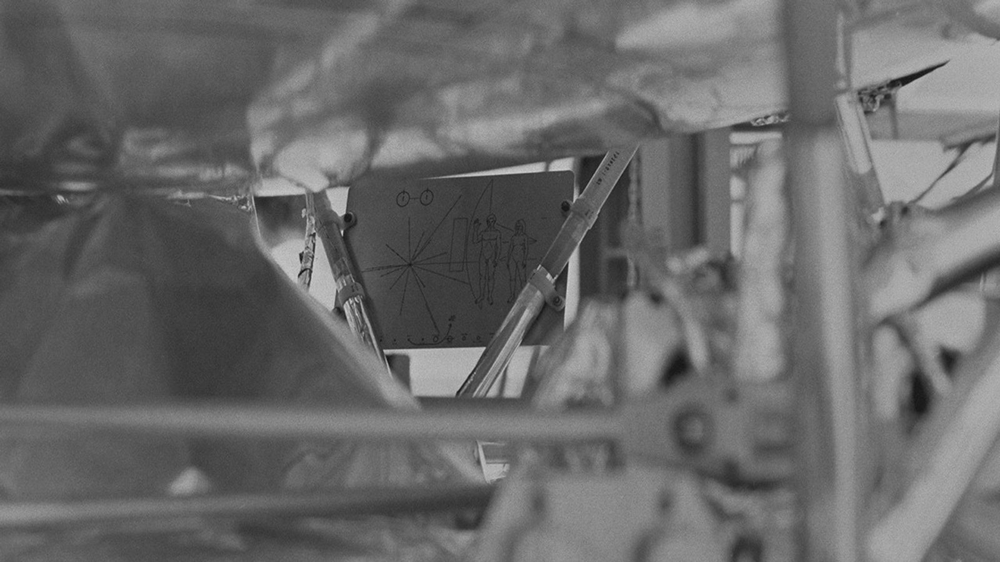

# Pioneer 10: Humanity's Historic First Pathfinder to Jupiter and the Outer Solar System

*Figure 1: Artist's concept of the Pioneer 10 spacecraft during its historic encounter with Jupiter, with the Great Red Spot visible on the gas giant's turbulent atmosphere.*

## Overview & Quick Facts

**Pioneer 10** (originally designated **Pioneer-F**) was one of the most triumphant, daring deep-space missions ever flown by NASA. Conceived and managed by NASA’s **Ames Research Center (ARC)**, Pioneer 10 was the true pathfinder for outer-solar-system exploration, boldly venturing where no human-made object had ever dared to travel. 

Pioneer 10 amassed an unmatched series of planetary firsts: the first spacecraft to fly beyond the orbit of Mars, the first to successfully penetrate and survive the treacherous main asteroid belt, the first to encounter Jupiter and transmit close-up imagery of the gas giant, the first to cross the orbit of Neptune, and the first object placed on an escape trajectory out of our solar system into interstellar space. Originally designed for a nominal mission of just 21 months, Pioneer 10 operated for over **30 years**, transmitting its final whisper back to Earth across 7.6 billion miles in January 2003.

| Parameter | Specification |
| :--- | :--- |
| **Mission Type** | Outer Planetary Flyby / Deep Space & Interstellar Probe |
| **Primary Target** | Jupiter & the Jovian Magnetosphere |
| **Launch Date** | March 2, 1972 (01:49:04 UT) |
| **Launch Site** | Cape Canaveral Air Force Station, Launch Complex 36A, Florida |
| **Launch Vehicle** | Atlas-Centaur with TE-M-364-4 third stage (AC-27 / Atlas 3C no. 5007C) |
| **Mission Management** | NASA Ames Research Center (ARC) / TRW Inc. |
| **Total Spacecraft Mass** | 569 lbs (258 kg) |
| **Power Source** | Four SNAP-19 Radioisotope Thermoelectric Generators (RTGs) (155 W at launch) |
| **Asteroid Belt Crossing** | July 15, 1972 – February 15, 1973 |
| **Closest Jupiter Approach**| December 4, 1973 (02:26 UT / distance 130,354 km / 81,000 miles) |
| **Crossed Orbit of Saturn** | February 1976 |
| **Crossed Orbit of Neptune**| June 13, 1983 (first object to venture beyond the furthest known planet) |
| **Routine Operations Ended** | March 31, 1997 |
| **Final Signal Received** | January 23, 2003 (from a distance of 12.23 billion km / 82 AU) |
| **Current Destination** | Heading toward Aldebaran (Alpha Tauri); travel time ~2 million years |

---

## Spacecraft Architecture & Power

The harsh, cold, low-light environment of the outer solar system necessitated rugged, pioneering hardware:
- **Spin Stabilization**: Pioneer 10 maintained orientation by spinning at a constant 4.8 revolutions per minute around its high-gain antenna axis, providing gyroscopic stability without needing complex three-axis reaction wheels.
- **Nuclear RTG Power**: Because solar radiation at Jupiter is only 4% of that at Earth, solar panels were completely unviable. Pioneer 10 was the **first spacecraft to rely entirely on nuclear electrical power**, carrying four SNAP-19 Radioisotope Thermoelectric Generators (RTGs) mounted on two 3-meter deployed booms. The RTGs used plutonium-238 decay heat converted to electricity by thermoelectric couples, generating ~155 W at launch.
- **High-Gain Antenna (HGA)**: A prominent 2.74-meter (9-foot) parabolic dish antenna dominated the spacecraft bus, continuously transmitting and receiving S-band radio signals via NASA’s Deep Space Network (DSN).

---

## Scientific Payload & Instruments

Pioneer 10 carried 11 advanced scientific experiments designed to investigate interplanetary space, the asteroid belt, and Jupiter’s magnetosphere and atmosphere:

1. **Imaging Photopolarimeter (IPP)**:
   - Gathered light intensity in two color bands (blue and red) as the spacecraft spun, building up line-by-line raster images of Jupiter, its cloud belts, and moons.
2. **Helium Vector Magnetometer (HVM)**:
   - Mounted on a 6.6-meter deployed boom to isolate it from spacecraft interference; measured the interplanetary and Jovian magnetic fields.
3. **Infrared Radiometer**:
   - Measured thermal emission to determine whether Jupiter radiated more heat than it absorbed from the Sun.
4. **Quadrispherical Plasma Analyzer**:
   - Detected solar wind protons and low-energy plasma particles.
5. **Charged Particle Instrument (CPI)**:
   - Measured high-energy electrons and cosmic rays.
6. **Cosmic Ray Telescope (CRT)**:
   - Analyzed the energy spectrum and composition of solar and galactic cosmic rays.
7. **Geiger Tube Telescope (GTT)**:
   - Measured intensity of high-energy electrons and protons in Jupiter's radiation belts.
8. **Trapped Radiation Detector (TRD)**:
   - Investigated extremely intense electron and proton fluxes trapped in Jupiter's magnetic field.
9. **Ultraviolet Photometer**:
   - Determined hydrogen-to-helium ratios in Jupiter's upper atmosphere.
10. **Sisyphus Asteroid/Meteoroid Detector (AMD) & Meteoroid Detectors**:
    - Measured the spatial density of micrometeoroids and dust particles through the asteroid belt.
11. **Radio Science & Occultation Experiment**:
    - Measured attenuation of radio signals during occultation behind Jupiter to measure atmospheric temperature and pressure profiles.

---

## Flight Profile & Planetary Discoveries

### 1. Conquering the Asteroid Belt (1972–1973)
Before Pioneer 10, scientists feared that the main asteroid belt between Mars and Jupiter was choked with dense clouds of lethal micrometeoroids capable of destroying any spacecraft. Pioneer 10 entered the belt on July 15, 1972, proving that the belt is vast, sparse, and easily navigable, opening the outer solar system to all future missions.

### 2. Historic Jupiter Encounter (Dec. 4, 1973)
Pioneer 10 sped past Jupiter at a blistering 126,000 km/h (78,000 mph), passing within 130,354 km (81,000 miles) of the cloud tops:
- **Intense Radiation Belts**: Pioneer 10 discovered that Jupiter’s magnetic field is millions of times more powerful than Earth's, enclosing radiation belts up to 10,000 times stronger than Earth’s Van Allen belts. The radiation dosage exceeded design tolerances, triggering false commands and frying the photopolarimeter just before closest approach to Io, but 6 of the 11 instruments operated continuously.
- **Atmosphere & Internal Heat**: Pioneer confirmed that Jupiter is a fluid gas giant consisting primarily of liquid hydrogen and helium, radiating approximately twice as much thermal energy as it receives from the Sun.
- **The Great Red Spot**: Captured detailed photographs showing the Great Red Spot as an immense anticyclonic atmospheric storm system.
- **Close-up Moon Imagery**:
  
  
  *Figure 2: The historic first close-up photograph of Jupiter's giant moon Ganymede, obtained by Pioneer 10's Imaging Photopolarimeter in December 1973.*

### 3. Crossing the Outer Solar System
- **1976**: Crossed Saturn’s orbit, revealing that Jupiter's immense magnetic tail extended over 800 million kilometers—stretching completely across the distance between the two planets.
- **June 13, 1983**: Crossed the orbit of Neptune (then the outermost planet due to Pluto's eccentric orbit), becoming the first human-built craft to pass beyond all known planets.
- **Interstellar Messenger**: Pioneer 10 maintained contact until January 23, 2003, when its decaying RTGs could no longer power the transmitter. Its final signal took 11 hours and 20 minutes to travel 7.6 billion miles to Earth.

---

## The Pioneer Plaque: Humanity’s Greeting to the Stars

*Figure 3: The gold-anodized aluminum Pioneer Plaque mounted to the antenna support struts, bearing humanity’s message to extraterrestrial civilizations.*

Because Pioneer 10 was doomed to wander the Milky Way galaxy for eternity, Carl Sagan, Linda Salzman Sagan, and Frank Drake designed a gold-anodized aluminum plaque ($152 	imes 229	ext{ mm}$):
- **Human Figures**: Depicts an adult human male and female standing before the silhouette of the spacecraft for scale.
- **Hydrogen Hyperfine Transition**: Illustrates the spin-flip transition of neutral atomic hydrogen, establishing universal fundamental units of time ($0.7	ext{ ns}$) and wavelength ($21	ext{ cm}$).
- **Pulsar Positioning Map**: Displays 14 lines radiating from the Sun to prominent galactic pulsars, with binary numbers encoding their pulse frequencies at launch time, allowing any intelligent extraterrestrial finder to pinpoint our solar system in time and space.
- **Solar System Layout**: Shows the planets of the solar system with Pioneer 10’s trajectory arcing outward past Jupiter into interstellar space.
