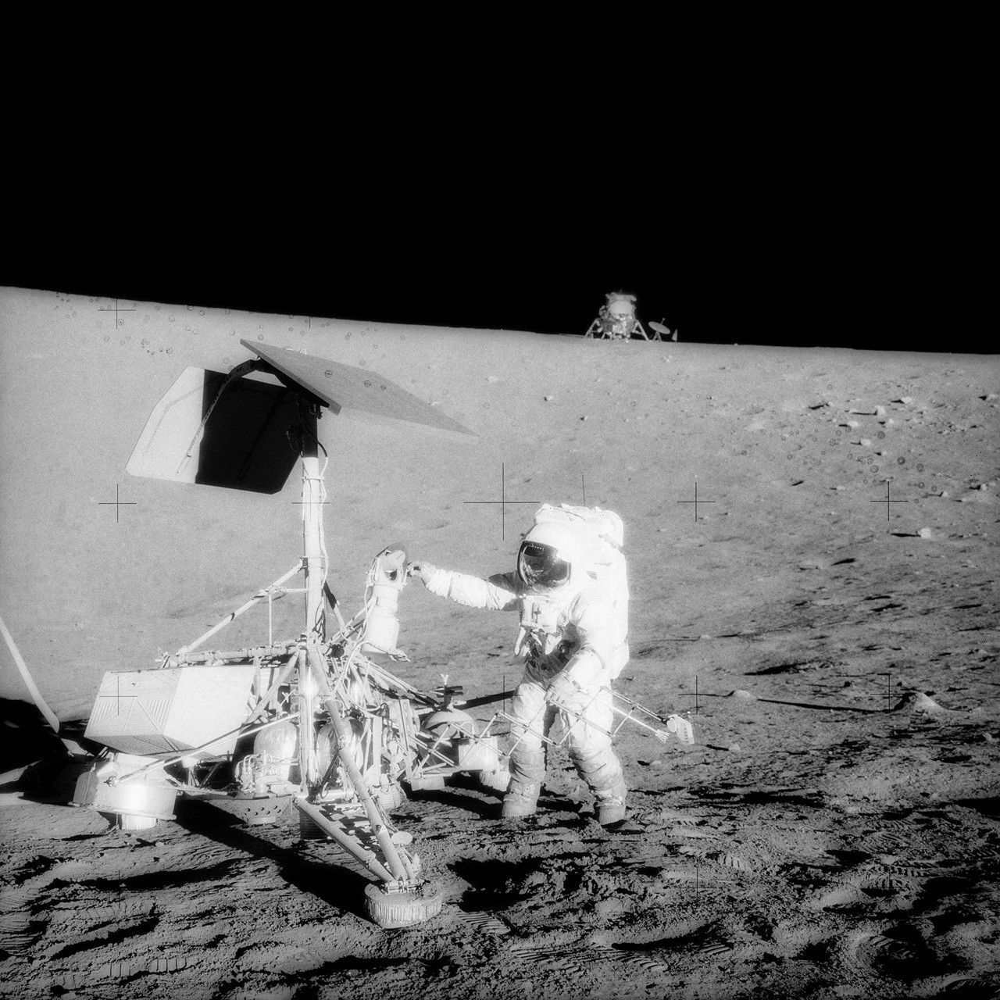
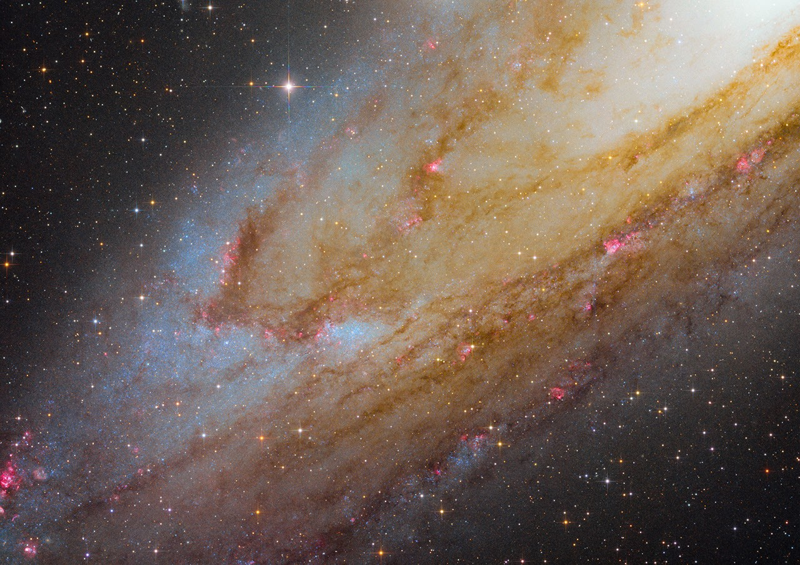

# Surveyor 3: Lunar Soft-Lander and Precursor to Apollo 12

*Figure 1: Apollo 12 Commander Charles "Pete" Conrad Jr. examines the robotic Surveyor 3 lander inside Surveyor Crater in Oceanus Procellarum, with the Lunar Module Intrepid visible in the background.*

## Overview & Quick Facts

**Surveyor 3** (Surveyor-C) was the second successful spacecraft in NASA’s historic Surveyor lunar soft-landing program, managed by the Jet Propulsion Laboratory (JPL) and built by Hughes Aircraft Company. Launched in April 1967, Surveyor 3 was tasked with proving that the Moon’s surface could structurally support the mass of an Apollo crewed Lunar Module.

Surveyor 3 achieved immortality in space history not only for its groundbreaking soil mechanics tests and thousands of television images, but because it became the **only robotic planetary lander in history to be visited by human astronauts**. On November 19, 1969, Apollo 12 astronauts Pete Conrad and Alan Bean executed a precision pinpoint landing just 180 meters (197 yards) away, walking across the lunar regolith to inspect Surveyor 3 and retrieve parts to bring back to Earth.

| Parameter | Specification |
| :--- | :--- |
| **Mission Type** | Lunar Soft-Lander (Surveyor Program) |
| **Target Destination** | Oceanus Procellarum (Ocean of Storms), Moon |
| **Landing Coordinates**| 3.0128° S latitude, 23.4219° W longitude (Surveyor Crater) |
| **Launch Date** | April 17, 1967 (07:05:01 UT) |
| **Launch Vehicle** | Atlas Centaur AC-12 (Atlas D no. 292 / Centaur D) |
| **Launch Site** | Cape Canaveral Air Force Station, Launch Complex 36B, Florida |
| **Mission Management** | NASA / Jet Propulsion Laboratory (JPL) |
| **Spacecraft Mass** | 2,200 lbs (997.9 kg) at launch; 625 lbs (283 kg) on lunar surface |
| **Lunar Landing Date** | April 20, 1967 (00:04:17 UT) |
| **Final Signal Received**| May 4, 1967 (two days into the freezing lunar night) |
| **TV Photographs** | **6,326 high-resolution television pictures** |
| **Apollo 12 Visit** | November 19–20, 1969 (Commander Pete Conrad & LMP Alan Bean) |

---

## Spacecraft Architecture & Landing Dynamics

*Figure 2: Official NASA rendering of the Surveyor 3 lander with its high-gain planar antenna, steerable solar panel, and three landing legs.*

- **Structure**: A triangular open tubular aluminum frame mounted on three hinged landing legs with crushed-aluminum honeycomb footpads.
- **Power**: A 0.85-square-meter steerable solar panel generating 85 W, paired with rechargeable silver-zinc batteries.
- **Propulsion & Landing Engines**: A solid-propellant Thiokol retro-rocket providing ~40,000 N thrust for initial lunar deceleration, plus three liquid monopropellant vernier engines capable of differential throttling (130 to 460 N thrust) for trajectory and terminal soft landing.

### The Historic "Three-Bounce" Landing
Surveyor 3 began its mission via parking orbit around Earth with a restartable Centaur upper stage. During terminal descent on April 20, 1967:
1. Highly reflective lunar rocks confused the lander’s radar altimeter and Doppler velocity sensors.
2. The main vernier engines failed to automatically cut off at the scheduled 14-foot (4.3-meter) altitude.
3. As a result, Surveyor 3 bounced off the lunar surface **twice**:
   - First bounce: leaped **33 feet (10 meters)** into the lunar sky.
   - Second bounce: leaped **10 feet (3 meters)**.
4. Ground controllers at JPL quickly intervened, sending a manual command from Earth to shut off the engines. Surveyor 3 settled softly into a 200-meter-wide crater inclined at 14 degrees.

---

## Scientific Instruments & Groundbreaking Discoveries

Surveyor 3 carried two primary scientific payloads:

1. **Vidicon Television Camera**:
   - Equipped with 25 mm and 100 mm focal length lenses, mounted beneath a rotatable 360-degree azimuth and elevation mirror.
   - Capable of both 200-line slow-scan pictures (transmitted in 20 seconds) and 600-line digital picture transmission.
   - Transmitted **6,326 television images**, mapping crater morphology, rocks, lunar sunsets, and an eclipse of the Sun by the Earth.
2. **Soil Mechanics Surface Sampler**:
   - An electric motor-driven robotic scoop mounted on a pantograph arm that could reach up to **5 feet (1.5 meters)** from the spacecraft and dig trenches up to **7 inches (18 cm)** deep.
   - Controlled by Earth commands, the scoop dug four trenches, executed four bearing-strength tests, and performed 13 impact tests.
   - **Critical Finding for Apollo**: Soil tests determined that lunar regolith had a consistency similar to **damp sand**, with a bearing capacity of approximately **10 pounds per square inch (0.7 kg/cm² / 98 kPa)**. This proved conclusively that the lunar crust would not swallow up the Apollo Lunar Module, giving NASA final confidence to land humans.

---

## The Apollo 12 Rendezvous & Forensic Examination

On November 19, 1969, Apollo 12’s Lunar Module *Intrepid* touched down just **180 meters (197 yards)** from Surveyor 3, demonstrating precision landing navigation:
- During their second Extravehicular Activity (EVA), astronauts Pete Conrad and Alan Bean walked down the slope of Surveyor Crater to the probe.
- They inspected the spacecraft, photographed its condition, and used specialized cutters to retrieve roughly **10 kilograms (22 lbs)** of components, including the TV camera, the mechanical scoop, electrical cabling, and structural aluminum tubing.
- **Forensic Scientific Results on Earth**:
  - Showed that lunar dust kicked up by micrometeorites and the Apollo 12 descent engine had darkened and sandblasted Surveyor’s painted surfaces.
  - Provided the first empirical benchmark of solar radiation, cosmic ray damage, and micrometeoroid cratering on man-made space hardware over 2.5 years of vacuum exposure.
  - Discovered viable *Streptococcus mitis* bacteria inside the camera foam—sparking decades of planetary protection research into microbial dormancy and terrestrial contamination during cleanroom assembly.
