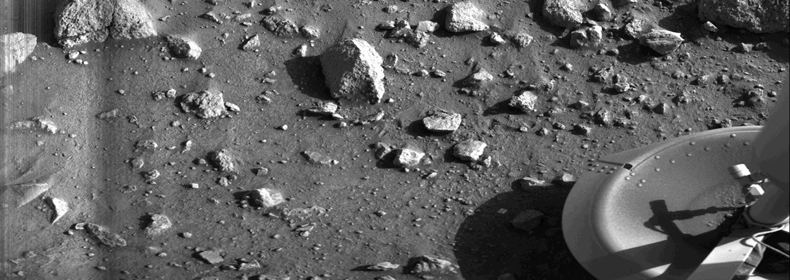
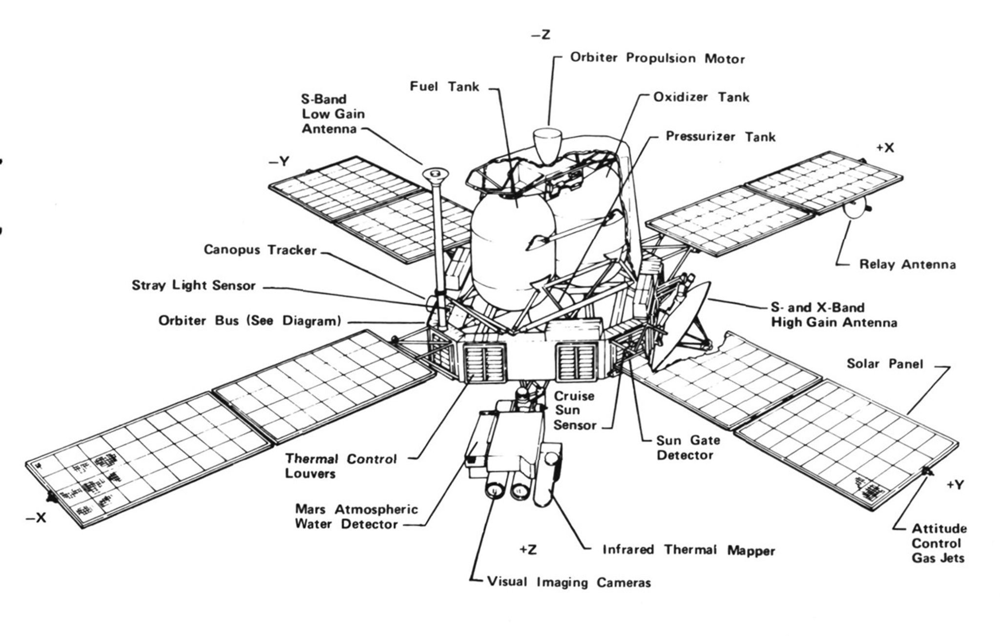
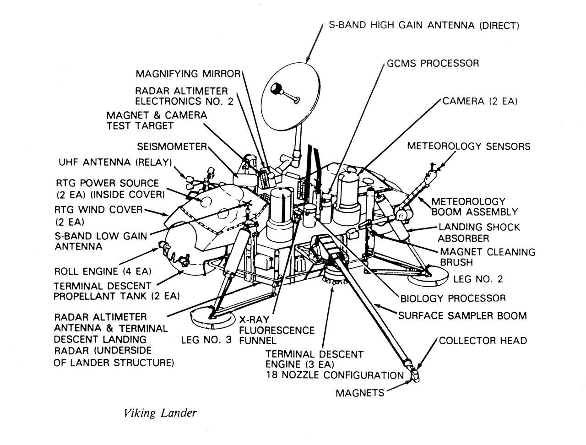

# Viking 1: Humanity's First Successful Touchdown and Operations on Mars

*Figure 1: The historic first photograph ever taken on the surface of Mars, captured by NASA’s Viking 1 lander on July 20, 1976, showing its footpad resting firmly on the Martian soil.*

## Overview & Quick Facts

NASA’s **Viking 1** (Viking-B) was one of the crowning triumphs of 20th-century planetary science. Launched in August 1975, Viking 1 was the first of a twin pair of sophisticated deep-space robotic missions (alongside Viking 2) designed to achieve the first truly successful landing on Mars and conduct the search for extraterrestrial life.

Each Viking spacecraft was a dual-vehicle package consisting of a massive orbital spacecraft and a heavily instrumented surface lander. On **July 20, 1976**—seven years to the day after Apollo 11 landed on the Moon—Viking 1 safely touched down on the wind-swept plains of **Chryse Planitia**. Viking 1 broke ground on planetary surface exploration, operating on the surface of Mars for over six years and sending back the first panoramic color views, comprehensive meteorological data, and chemical soil analyses of the Red Planet.

| Parameter | Specification |
| :--- | :--- |
| **Mission Type** | Combined Mars Orbiter and Atmospheric Entry Lander |
| **Target Destination** | Chryse Planitia (Golden Plain), Mars |
| **Landing Coordinates**| 22.483° N latitude, 47.94° W longitude |
| **Launch Date** | August 20, 1975 (21:22:00 UT) |
| **Launch Vehicle** | Titan IIIE-Centaur (TC-4 / Titan no. E-4 / Centaur D-1T) |
| **Launch Site** | Cape Canaveral Air Force Station, Launch Complex 41, Florida |
| **Mission Management** | NASA Langley Research Center (LaRC) / Jet Propulsion Laboratory (JPL) |
| **Total Spacecraft Mass** | 7,776 lbs (3,527 kg) at launch |
| **Orbiter Mass** | 5,157 lbs (2,339 kg) fueled; 1,984 lbs (900 kg) dry |
| **Lander Mass** | 2,156 lbs (978 kg) landed on Mars surface |
| **Lander Power System** | Two SNAP-19 Radioisotope Thermoelectric Generators (RTGs) (57 W) |
| **Orbiter Power System** | Four solar array wings with 34,800 solar cells (620 W) |
| **Mars Orbit Insertion** | June 19, 1976 (operational orbit 1,500 × 32,800 km) |
| **Mars Landing Date** | July 20, 1976 (11:53:06 UT) |
| **Orbiter Shutdown** | August 7, 1980 (attitude-control gas depleted after 1,485 orbits) |
| **Lander Last Contact** | November 11, 1982 (faulty ground command overwrote antenna pointing) |

---

## Spacecraft Architecture & Flight Subsystems

### 1. The Viking Orbiter

*Figure 2: Engineering line drawing and structural blueprint of the Viking Orbiter.*

- Based heavily on the Mariner 9 bus, featuring an octagonal aluminum prism with four solar wings spanning 9.75 meters tip-to-tip.
- Carried a bi-propellant rocket engine (hydrazine and nitrogen tetroxide) producing 1,323 N thrust for Mars orbit insertion and orbital trimming.
- Served as the primary communications relay station for the lander, receiving UHF data from the surface and relaying it to Earth at 16 kbit/s.

### 2. The Viking Lander & Aeroshell

*Figure 3: Engineering line drawing and payload layout of the Viking Lander.*

- **Biosterilization**: Before launch, the entire lander sealed inside its bioshield capsule was baked in an oven at $111^\circ	ext{C}$ ($232^\circ	ext{F}$) for 40 hours to destroy all terrestrial spores and microbes, preserving planetary quarantine.
- **Entry & Descent**: Encased in an aerodynamic aeroshell heat shield, Viking atmospheric entry began with a deorbit burn. A 16-meter parachute deployed at 6 km altitude, followed by terminal braking from three monopropellant hydrazine retro-rockets (throttling from 276 to 2,667 N) to prevent surface contamination.
- **Power**: Two SNAP-19 RTGs enclosed in thermal shields provided continuous electrical power and heat, unaffected by dust accumulation or freezing Martian nights.

---

## Scientific Payloads & Experiments

### Orbiter Instruments:
1. **Visual Imaging System (VIS)**: Twin high-resolution Vidicon cameras returned tens of thousands of global orbital photographs, identifying ancient riverbeds, mega-floods, volcanoes, and canyons.
2. **Infrared Spectrometer for Water Vapor Mapping (MAWD)**: Mapped atmospheric humidity and water vapor circulation.
3. **Infrared Radiometer for Thermal Mapping (IRTM)**: Measured surface temperature profiles across Mars.

### Lander Instruments:
1. **Surface Facsimile Cameras**: Two scanning optical facsimile cameras providing 300-degree panoramic imagery, stereoscopic depth, and color photos.
2. **Biology Instrument Package (Life Detection Experiments)**:
   - *Gas Exchange Experiment (GEX)*: Monitored gas composition changes after adding nutrients and water to soil.
   - *Pyrolytic Release Experiment (PR)*: Tested for carbon fixation under simulated Martian sunlight.
   - *Labeled Release Experiment (LR)*: Detected radioactive $^{14}C$ gas emission after moistening soil with a $^{14}C$-labeled nutrient broth.
3. **Gas Chromatograph-Mass Spectrometer (GCMS)**:
   - Pyrolyzed and analyzed soil and atmospheric samples down to parts-per-billion sensitivity to detect organic molecules.
4. **X-Ray Fluorescence Spectrometer (XRFS)**:
   - Measured inorganic elemental abundance (iron, silicon, calcium, aluminum, sulfur, chlorine) in Martian soil.
5. **Meteorology Instrument Package**:
   - Measured ambient atmospheric pressure, wind speed, wind direction, and temperature continuously.
6. **Seismometer**:
   - Designed to measure marsquakes (Viking 1's seismometer failed to uncage; Viking 2's operated successfully).
7. **Remote Sampler Arm**:
   - A 3-meter retractable boom equipped with a motorized backhoe scoop, temperature sensor, and magnet array to collect soil and dump it into instrument funnels.

---

## Discoveries & Scientific Legacy

1. **The First High-Resolution Mars Panoramas**: Transmitted sharp panoramic views showing a dry, rocky desert landscape dotted with angular basalt boulders beneath a butterscotch-pink sky (tinted by airborne red iron oxide dust).
2. **Soil Chemistry & The Life Detection Paradox**:
   - The Labeled Release experiment initially showed rapid evolution of radioactive carbon dioxide gas—a potential biological signature.
   - However, the ultra-sensitive GCMS detected **no organic compounds** in the soil (less than a few parts per billion).
   - Scientists concluded the soil was lifeless at the surface, containing aggressive chemical super-oxidants (like perchlorates and hydrogen peroxide) produced by ultraviolet radiation that destroy organic molecules.
3. **Atmospheric Pressure & CO2 Cycles**: Viking monitored the Martian atmosphere over multiple Mars years, observing global pressure swings of over 30% as atmospheric carbon dioxide froze out and sublimated seasonally onto the winter polar caps.
4. **Global Mapping**: The Viking orbiters returned 52,663 photos, mapping 97% of the planet's surface and proving that early Mars possessed vast quantities of liquid water that carved gigantic outflow channels.
