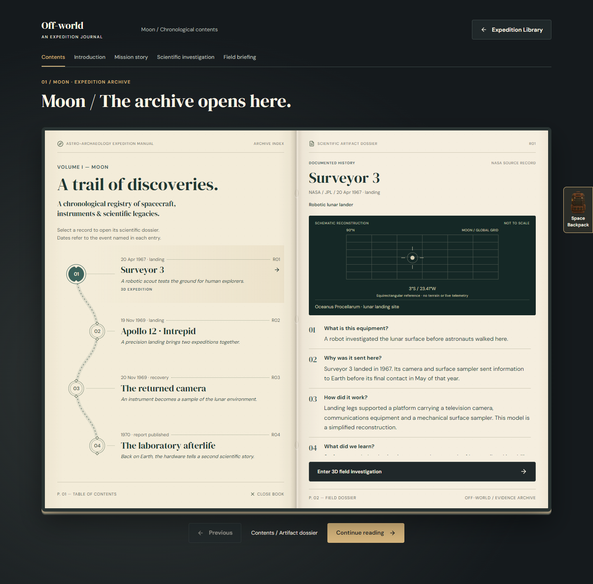
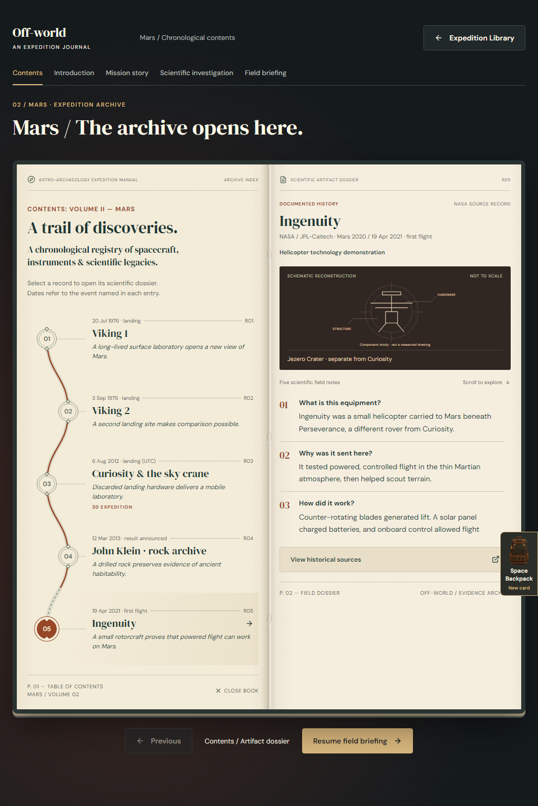
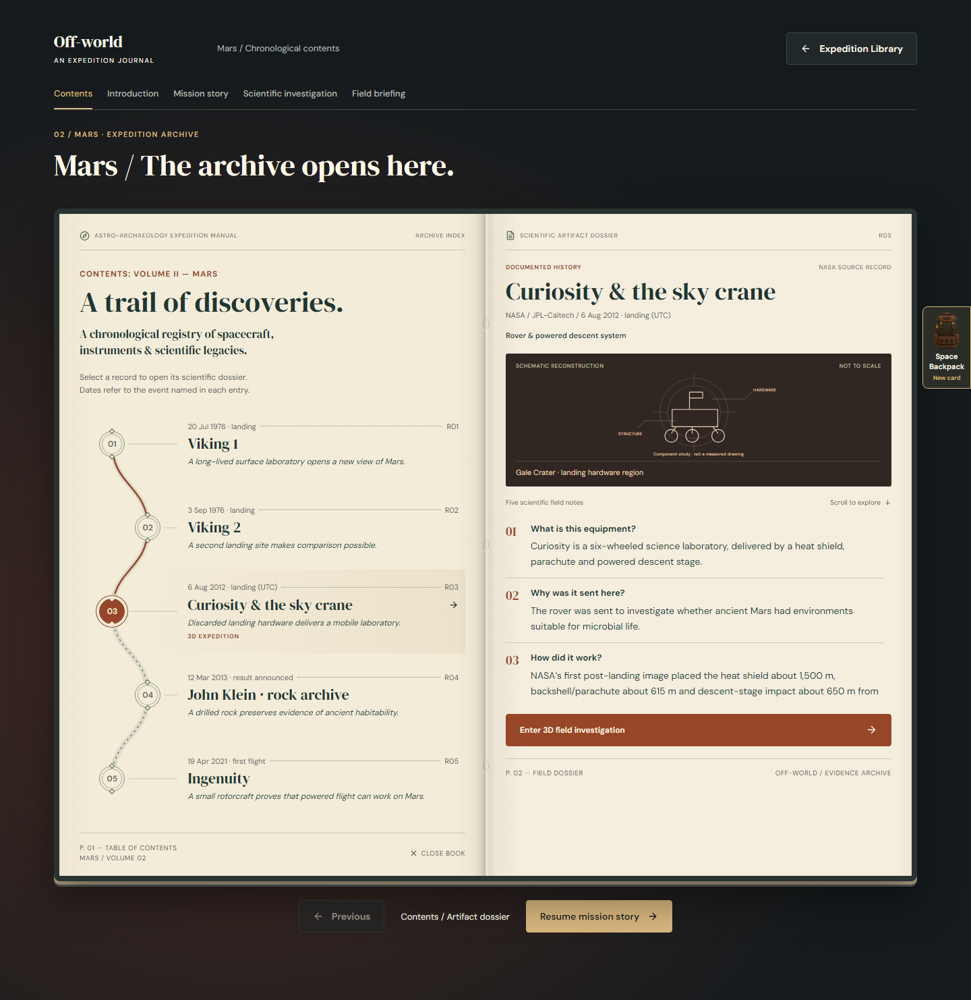
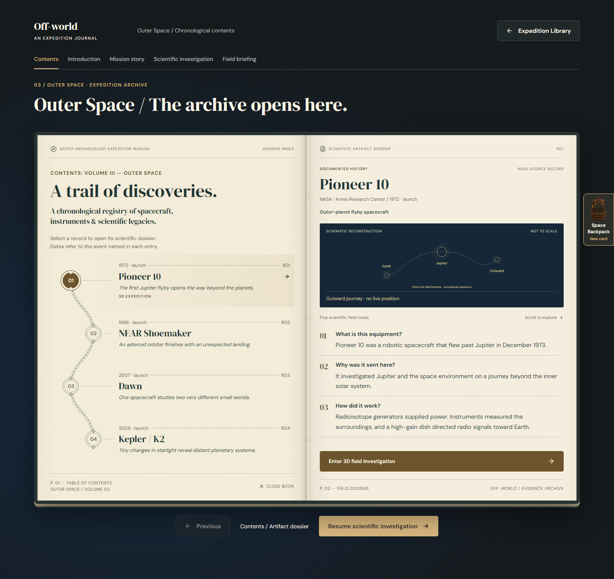
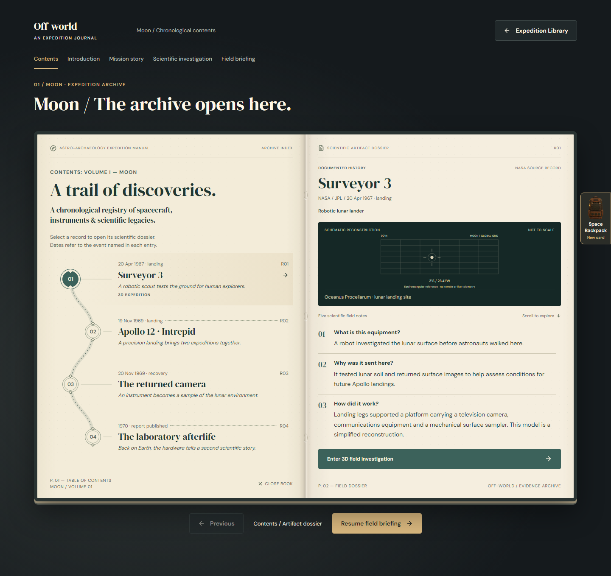

# Off-World — An Interactive Space History Explorer

> Explore humanity's greatest space missions through immersive 3D reconstructions, primary-source archives, and hands-on evidence investigations — designed for ages 12–16.

[Off-World Demo](docs/GIF_4.gif)

---

## Screenshots

**Book Reader — Mission Briefing & Dossier**



**Mission Contents — Mars Volume**



| Curiosity · Mars Science Laboratory | Pioneer 10 · Deep Space |
|---|---|
|  |  |

| Surveyor 3 / Apollo 12 · Moon | |
|---|---|
|  | |

---

## What is Off-World?

Off-World is a desktop-first interactive expedition journal built for the **NASA Space Apps Challenge 2025**. Players choose one of three mission books (Moon, Mars, or Outer Space), read the historical record, then step into a fictional future expedition to inspect real NASA hardware in a cel-shaded 3D environment. Each mission challenges the player to examine four sourced discoveries, draw an evidence conclusion, and earn a collectible mission card in their Space Backpack.

The app runs entirely in the browser — no login, no audio required, no live telemetry. All scientific descriptions link directly to NASA/JPL source records.

---

## Missions

| Book | Mission | Location |
|------|---------|----------|
| 🌕 Moon | Surveyor 3 / Apollo 12 | Ocean of Storms |
| 🌕 Moon | Apollo 12 / Intrepid | Fra Mauro region |
| 🔴 Mars | Viking 1 | Chryse Planitia |
| 🔴 Mars | Viking 2 | Utopia Planitia |
| 🔴 Mars | Curiosity | Gale Crater |
| 🔴 Mars | Ingenuity | Jezero Crater |
| 🌌 Outer Space | Pioneer 10 | Deep Space |
| 🌌 Outer Space | NEAR Shoemaker | Asteroid 433 Eros |
| 🌌 Outer Space | Dawn | Asteroid Belt (Vesta & Ceres) |
| 🌌 Outer Space | Kepler / K2 | Heliocentric Orbit |

---

## NASA Data Used

All mission narratives, discoveries, and evidence records are sourced directly from official NASA archives:

| Mission | Primary Source |
|---------|---------------|
| Curiosity | [NASA Science — Curiosity](https://science.nasa.gov/mission/msl-curiosity/) · [JPL PIA16001](https://www.jpl.nasa.gov/images/pia16001-scene-of-a-martian-landing/) |
| Viking 1 & 2 | [NASA Photojournal — PIA00381, PIA00384, PIA00393](https://photojournal.jpl.nasa.gov/) · [NSSDC Viking](https://nssdc.gsfc.nasa.gov/nmc/spacecraft/display.action?id=1975-075A) |
| Ingenuity | [NASA Science — Ingenuity](https://science.nasa.gov/mission/ingenuity/) · NASA JPL press kit |
| Surveyor 3 / Apollo 12 | [NASA Science — Apollo 12 & Surveyor 3](https://science.nasa.gov/resource/apollo-12-and-surveyor-3/) · [NTRS Recovery Report](https://ntrs.nasa.gov/citations/19710024418) |
| Pioneer 10 | [NASA Science — Pioneer 10](https://science.nasa.gov/mission/pioneer-10/) · [3D Model](https://science.nasa.gov/3d-resources/pioneer/) |
| NEAR Shoemaker | [Johns Hopkins APL — NEAR](https://near.jhuapl.edu/) · NASA NSSDC |
| Dawn | [NASA Science — Dawn](https://science.nasa.gov/mission/dawn/) · [Dawn Spacecraft](https://science.nasa.gov/mission/dawn/technology/spacecraft/) · NASA/JPL-Caltech/UCLA/MPS/DLR/IDA (Ceres imagery) |
| Kepler / K2 | [NASA Science — Kepler](https://science.nasa.gov/mission/kepler/) · [Kepler 3D Model](https://science.nasa.gov/resource/kepler-spacecraft/) |

---

## Installation & Running

**Requirements:** Node.js 22 or newer, npm

```sh
# Clone the repository
git clone https://github.com/Aravinda-04/NASA-SPACE-APPS.git
cd NASA-SPACE-APPS

# Install dependencies
npm ci

# Start the development server
npm run dev
```

Open the local address printed by Vite in your browser.

### Production Build

```sh
# Verify mission content and run checks
npm test

# Build for production
npm run build

# Preview the production build locally
npm run preview
```

---

## Controls

| Action | Control |
|--------|---------|
| Move | WASD |
| Look | Drag or **Capture Mouse** |
| Switch camera | C |
| Show discoveries | J |
| Inspect hardware | F |
| Jetpack up / down | E / Space · Q / Control |
| Sprint | Shift |
| Release mouse / close | Escape |
| Navigate book pages | ← → arrow keys |

---

## Tech Stack

| Layer | Technology |
|-------|-----------|
| Framework | React 18 + TypeScript |
| Build Tool | Vite |
| 3D Engine | Three.js via `@react-three/fiber` and `@react-three/drei` |
| 3D Models | NASA official GLB assets, Draco-compressed |
| Styling | Custom CSS — `offworld.css`, `rewards.css`, `exploration.css` |
| Persistence | `localStorage` (`offworld-expedition:v2`) |
| Fonts | Self-hosted, licensed — see [`docs/fonts.md`](docs/fonts.md) |
| Draco Decoder | Local runtime copy (Apache 2.0) — no CDN dependency |

---

## Project Structure

```
src/
  features/
    book/          # Cover, page turns, briefings, journal and sources
    exploration/   # Walking/EVA, archive HUD, tasks and 3D worlds
  data/            # Mission stories, discoveries and source references
  types/           # Shared mission and progress contracts
  utils/           # Progress persistence and cel-shading helper
  styles/          # Global styles and recovery states
  App.tsx          # Application flow and saved progress
public/
  models/          # NASA GLB spacecraft models (Draco compressed)
  fonts/           # Self-hosted fonts and their licenses
  vendor/draco/    # Local model decoder
docs/              # Development notes, asset credits, screenshots
scripts/           # Mission content and progress validation
PRODUCT.md         # Product requirements and scope
DESIGN.md          # Implemented design system
```

---

## Team · 23SpaceOps

| Name | Role |
|------|------|
| Sandun Kodituwakku | Team Lead |
| Aravinda Gunawardana | Developer |
| Pasan Wijerathne | Developer |
| Prabhasara Vidulanka | 3D Artist |
| Thisum Danthanarayana | Developer |

---

## The Challenge

**NASA Space Apps Challenge 2025**

Off-World was built for the NASA Space Apps Challenge, the world's largest annual space and science hackathon. Our submission explores how educational storytelling, interactive 3D environments, and primary NASA source archives can make space mission history accessible and engaging for the next generation of explorers.

---

## AI Tools Used

| Tool | Purpose |
|------|---------|
| **Google Gemini (Gemini 2.5 Flash)** | System architecture design, React/TypeScript component generation, mission data research and historical accuracy verification, 3D scene procedural geometry (asteroid mesh, lunar terrain, star fields), TypeScript debugging, coordinate geometry verification |
| **Antigravity (Gemini Agent)** | End-to-end development workflow automation — file editing, build verification, git operations, test suite execution, and iterative mission implementation |

> AI-generated code, schematic geometry, and educational copy are used throughout. No AI-generated image is presented as historical evidence. All scientific descriptions link to official NASA/JPL records.

---

## Attribution & Boundaries

- All exploration scenes are illustrative reconstructions in a fictional future expedition. No future astronaut visit or future hardware state is a historical claim.
- The supplied spacecraft models are NASA educational 3D resources. Asset-specific credits and licenses are preserved in [`docs/assets.md`](docs/assets.md).
- This project does not imply NASA endorsement.
- No live telemetry, georeferenced terrain reconstruction, or archival video is included.

See [full asset provenance](docs/assets.md) · [font licenses](docs/fonts.md) · [verification notes](docs/quality/verification.md)

---

## Live Demo

🚀 *Demo link to be added after deployment.*